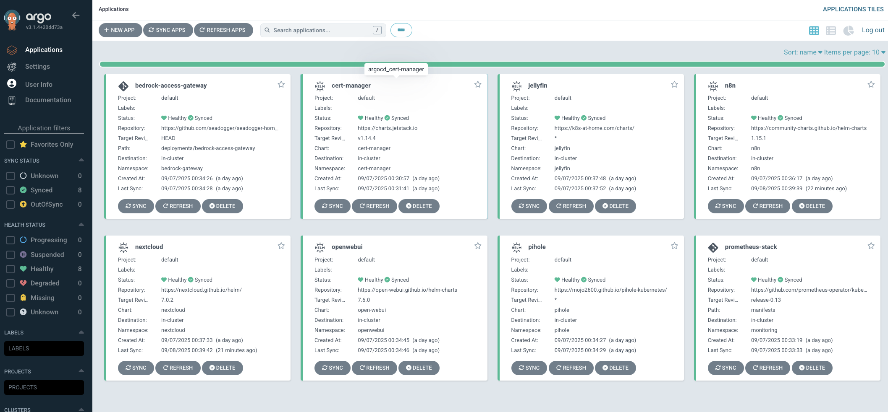
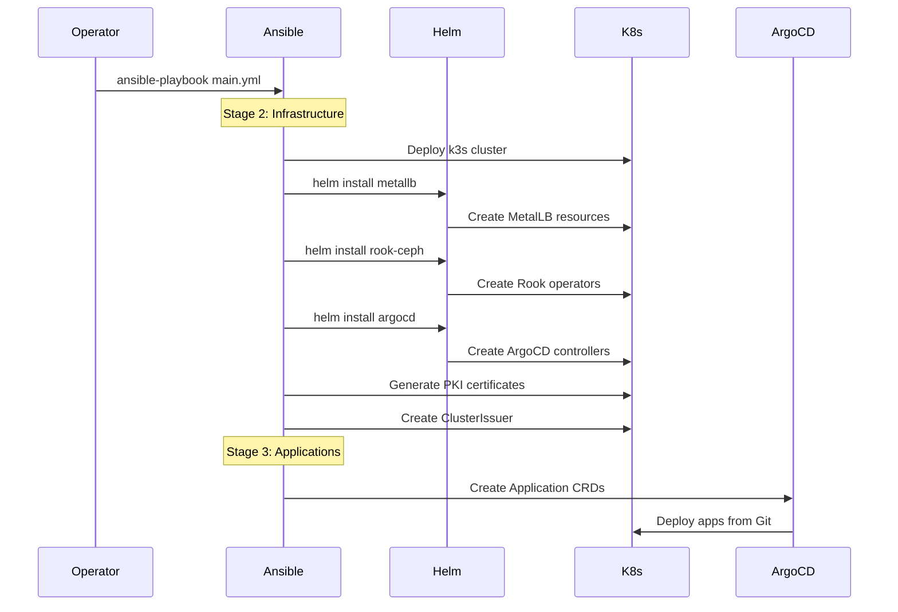
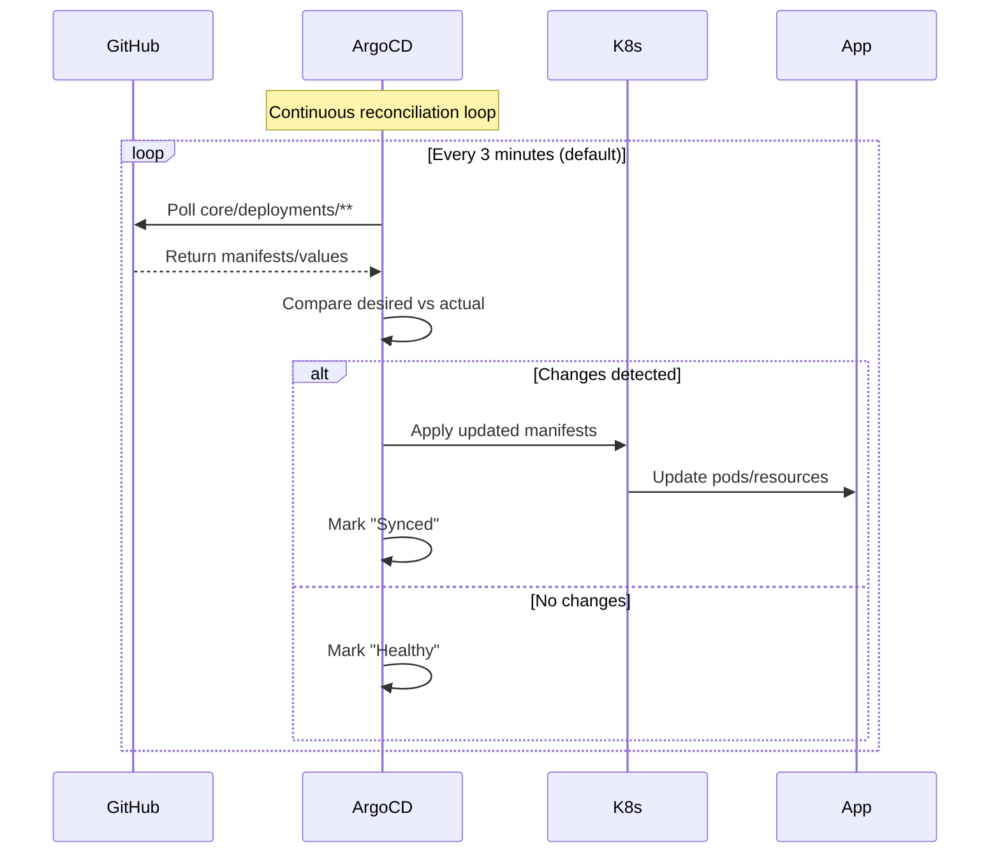
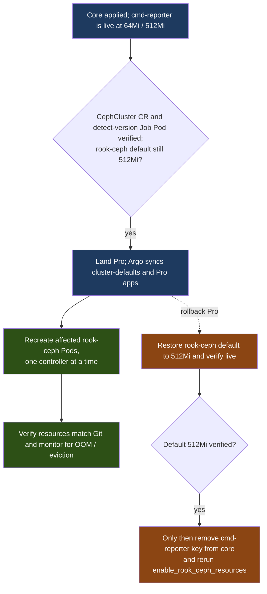
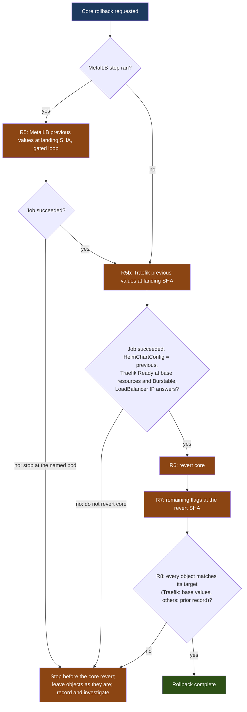
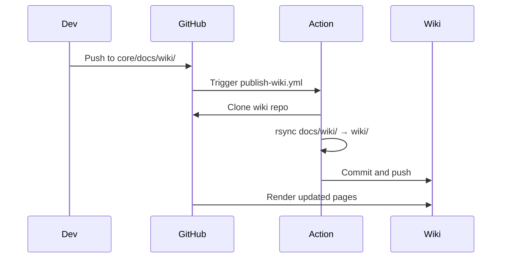
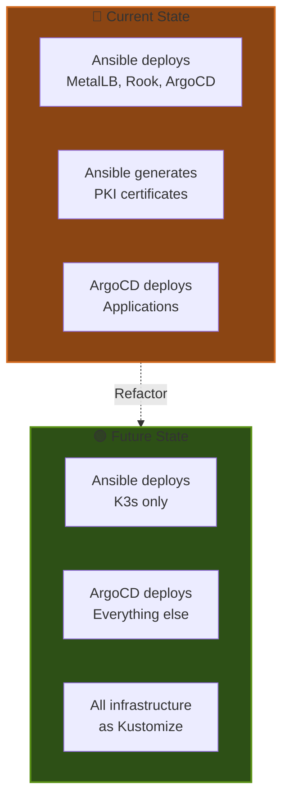

# GitOps & IaC

---
> **🌙 Diagram Viewing Recommendation**
>
> The interactive Mermaid diagrams below are **optimized for GitHub Dark Mode** to provide maximum readability and visual impact.
>
> **To enable Dark Mode:** GitHub Settings → Appearance → Theme → **Dark default**
>
> *Light mode users can still view the diagrams, though colors may appear less vibrant.*
---

This page explains how automation is split between Ansible and ArgoCD, and provides a practical test plan.

For CI/CD automation and repo workflows, see [[15-CI-CD-and-GitHub-Actions]].




## How it fits together

- Ansible is the orchestrator for infrastructure and bootstrap:
  - k3s control plane/workers, firmware, kernel settings
  - MetalLB, Rook‑Ceph (operators/CRDs), ArgoCD (native)
  - Internal PKI with cert‑manager (Root/Intermediate, ClusterIssuer, per‑app certs)
  - App deployment triggers via per‑app task files

- ArgoCD manages desired state for apps and some infra components via Git:
  - Sources from `core/deployments/**` (Helm values and manifests)
  - Reconciles Kubernetes resources for apps like Pi-hole, n8n, Jellyfin, Nextcloud

- Domains & certificates:
  - Services: `*.seadogger-homelab`
  - Issuer: `internal-local-issuer`
  - TLS secrets: `*-local-tls`

- Operator switches (in `ansible/config.yml`):
  - `cold_start_stage_1_wipe_cluster` (destructive; `cleanup.yml` only)
  - `cold_start_stage_2_install_infrastructure` (infra via `main.yml`)
  - `cold_start_stage_3_install_applications` (apps via `main.yml`)
  - `manual_install_*` flags per app


## Deployment Pipeline: Ansible → Helm → ArgoCD → GitHub

This section explains the complete deployment flow from initial code changes to running applications.

### Overview: The Complete Flow

```mermaid
graph LR
    Dev[👤 Developer] -->|1. Git Push| GitHub[📦 GitHub<br/>seadogger-homelab]
    GitHub -->|2. Checkout| Ansible[⚙️ Ansible<br/>Playbooks]
    Ansible -->|3a. Deploy Infra| Helm[📊 Helm<br/>Charts]
    Helm -->|3b. Install| K8s[☸️ Kubernetes<br/>Cluster]
    Ansible -->|4. Bootstrap| ArgoCD[🔄 ArgoCD]
    ArgoCD -->|5. Watch| GitHub
    ArgoCD -->|6. Sync| K8s
    GitHub -->|7. Wiki Update| WikiAction[🤖 GitHub Action]
    WikiAction -->|8. Publish| Wiki[📖 GitHub Wiki]

    style Dev fill:#7b1fa2,stroke:#9c27b0,stroke-width:2px
    style GitHub fill:#2d5016,stroke:#5a9216,stroke-width:2px
    style Ansible fill:#1e3a5f,stroke:#4a90e2,stroke-width:2px
    style Helm fill:#1e3a5f,stroke:#4a90e2,stroke-width:2px
    style K8s fill:#1e3a5f,stroke:#4a90e2,stroke-width:2px
    style ArgoCD fill:#8b4513,stroke:#d2691e,stroke-width:2px
    style WikiAction fill:#2d5016,stroke:#5a9216,stroke-width:2px
    style Wiki fill:#2d5016,stroke:#5a9216,stroke-width:2px
```



### 1. Developer Workflow

**Developer makes changes locally:**
```bash
# Edit deployment manifests, Helm values, or Ansible playbooks
cd /path/to/seadogger-homelab-pro/core
vim deployments/nextcloud/nextcloud-values.yaml

# Commit and push to core repo
git add . && git commit -m "Update Nextcloud configuration" && git push

# Update Pro repo submodule pointer
cd /path/to/seadogger-homelab-pro
git add core && git commit -m "Update core submodule: Nextcloud config" && git push
```

**What happens:** Changes are now in GitHub, ready for deployment or automated sync.

### 2. Infrastructure Bootstrap (Ansible → Helm → Kubernetes)

**Initial cluster setup uses Ansible:**



**Ansible's responsibilities:**
- **Bootstrap only** - One-time cluster setup
- **Helm wrapper** - Installs MetalLB, Rook-Ceph, ArgoCD using Helm
- **PKI setup** - Generates Root/Intermediate CA certificates
- **ArgoCD bootstrap** - Creates initial Application resources

**What Ansible does NOT do:**
- ❌ Manage application state (ArgoCD handles this)
- ❌ Update apps after initial deployment (GitOps takes over)
- ❌ Track drift (ArgoCD auto-syncs from Git)

### 3. GitOps Operation (ArgoCD ← → GitHub)

**After bootstrap, ArgoCD takes over:**



**ArgoCD's responsibilities:**
- **Continuous sync** - Polls Git every 3 minutes
- **Drift detection** - Compares cluster state to Git
- **Auto-healing** - Reverts manual changes back to Git state
- **Health checks** - Monitors application health

#### Cluster-default LimitRanges

The Pro repository's `deployments/cluster-defaults/` is managed by the `cluster-defaults` ArgoCD application. Ansible creates that Application only when `enable_cluster_defaults` is true; the switch defaults to false. The Application uses automated sync with pruning disabled and self-healing enabled. Its LimitRanges target existing namespaces, so it does not create namespaces.

Every Container limit item must set `defaultRequest` explicitly. Without it, Kubernetes can default a container's request to its memory limit and reserve much more schedulable memory than intended. Stage A adopted the live values unchanged. Stage B0 changes only the measured rook-ceph default below; later Stage B sizing still waits for the clean measured week. LimitRange values change only through Git.

Stage B0 lowers only the rook-ceph default. `defaultRequest` stays unchanged:

| Namespace | `defaultRequest` | `default` before B0 | `default` after B0 |
| --- | --- | ---: | ---: |
| `rook-ceph` | `cpu: 10m`, `memory: 64Mi` | `512Mi` | `72Mi` |
| `cert-manager` | `cpu: 10m`, `memory: 32Mi` | `256Mi` | `256Mi` (unchanged) |

A default reduction requires at least seven days of `memory.peak` for **every** consumer that inherits its limit. Inventory live Pods and every workload template, including init containers, Jobs and CronJobs, the Helm chart rendered with its configured values, Helm hooks, and Argo hooks or sync-wave Jobs. Include ended-container series. If any consumer lacks the full window or a series, keep the existing memory `default` and raise `defaultRequest` to match it. Otherwise set both to `max(<minimum-memory>, 1.25 × <largest-peak>)`, rounded up to 8Mi. Recheck the complete inventory and window when building a later change; a sample of live Pods is not enough.

When an inherited init container must be Guaranteed, make its LimitRange `default` equal to `defaultRequest` for both CPU and memory. Use placeholders in public examples, such as `cpu: <cpu>` and `memory: <memory>` on both sides. Kubernetes applies these values to omitted container resources; matching requests and limits lets the init container join an otherwise Guaranteed Pod. The evidence gate above still applies before lowering a memory default.

The rook-ceph default consumers are the unset CSI sidecars below. The private Pro Build ticket's fixture records every live pod/container instance, its measured peak, and its measurement window.

| Inheriting workload container | Templates |
| --- | --- |
| CSI controller `csi-attacher` | CephFS and RBD |
| CSI controller `csi-provisioner` | CephFS and RBD |
| CSI controller `csi-resizer` | CephFS and RBD |
| CSI controller `csi-snapshotter` | CephFS and RBD |
| CSI node-plugin `driver-registrar` | CephFS and RBD |

The rook CSI controller's other containers, the CSI node plugins and liveness sidecars, Rook/Ceph workloads, and the OSD-prepare Job's `provision` and `copy-bins` init container have explicit memory resources, so they do not inherit this default. The OSD-prepare Job template was checked as well as its completed Pods.

The cert-manager controller, cainjector and webhook inherit that namespace's default. The chart also enables `cert-manager-startupapicheck`, a short-lived `post-install` hook Job with empty resources; Argo runs it as a PostSync hook on sync. No live Job exists for a seven-day peak measurement, so the cert-manager default remains at `256Mi` and must not be lowered under the seven-day evidence rule.

The B0 check applies the spec's 1.25× sizing and 8Mi rounding to the private rook-ceph fixture. Other namespace defaults remain unchanged because their Jobs, init containers or workload windows do not meet this cut's evidence rule.

For the Pro B0 rollout, first land and apply the core half. After `enable_rook_ceph_resources` succeeds, verify the live CephCluster `spec.resources.cmd-reporter` and a `rook-ceph-detect-version` Job Pod both show a 64Mi request and 512Mi limit; also verify that the live rook-ceph LimitRange still has a 512Mi default. Record this gate on the Merge-to-main task before Pro lands. Then let Argo sync `cluster-defaults`, `google-mcp` and `ember-trail`, and recreate only the affected rook-ceph Pods, one controller at a time, by deleting each Pod. Verify the recreated Pod resources match Git. The `operations-mcp` Application is Ansible-owned: advance its `targetRevision` only by running the tagged Ansible task through the scoped runner with a reviewed 40-character lowercase commit SHA. ArgoCD then syncs that pinned SHA; it does not advance the Application when Pro files change.



The `cmd-reporter` key must remain live for as long as the rook-ceph default is below 512Mi. On rollback, restore and verify the live 512Mi default before removing that key from core and rerunning the runner flag.

#### Rolling back a change that adds an apply flag

A change that adds a runner apply flag (an `enable_*_resources` switch, or a variable a task now accepts) must roll back its own objects **at the landing SHA**, before the revert. The revert removes the flag, so a rollback run at the revert SHA cannot reach the objects the flag manages. Rolling back at the landing SHA first leaves the revert with nothing live to change. MetalLB's rollback (R5) and Traefik's (R5b) are the examples: each runs its flag at the landing SHA with a `previous` values file, and the core revert comes only after both gates pass.

**Companion rule:** if an object drifted from Git before the rollout, it rolls back to the Git value at the base, not to the live state captured before the rollout. The captured state is evidence for the "live equals Git" gate. It is not a rollback target. Traefik is the example: its live HelmChartConfig held the Stage B1 values while Git at the base held the earlier values, so R5b restores the base values from `traefik_helmchartconfig_values.previous.yml`, and rollback checks Traefik against those.

Rollback order when core also reverts:

1. **R5, only if the MetalLB step ran:** run the MetalLB flag at the landing SHA with the `previous` values and the gated loop. It replaces only the stale speakers the forward loop replaced; a speaker the forward loop never reached is already current and stays untouched, so a partial rollout leaves untouched speakers untouched. The Job must succeed, or the rollback stops at the named pod.
2. **R5b, always:** run the Traefik flag at the landing SHA with `traefik_values_file=traefik_helmchartconfig_values.previous.yml`. The Job must succeed, the live HelmChartConfig must equal the `previous` file, Traefik must be Ready at the base resources and `Burstable`, and its LoadBalancer IP must answer.
3. **Revert core,** only after R5 (if it ran) and R5b both pass. If a gate fails, stop before the revert and investigate at the landing SHA.



**Example ArgoCD Application:**
```yaml
apiVersion: argoproj.io/v1alpha1
kind: Application
metadata:
  name: nextcloud
  namespace: argocd
spec:
  project: default
  source:
    repoURL: https://github.com/seadogger-tech/seadogger-homelab
    path: deployments/nextcloud
    targetRevision: HEAD
  destination:
    server: https://kubernetes.default.svc
    namespace: nextcloud
  syncPolicy:
    automated:
      prune: true      # Delete resources removed from Git
      selfHeal: true   # Revert manual changes
    syncOptions:
      - CreateNamespace=true
```

#### Core apps: how a change reaches the cluster (Stage B3)

Each core app reaches the cluster by one of three paths, and the path decides how a size or placement change lands and how it rolls back.

| Path | Apps | How a change lands | How it rolls back |
| --- | --- | --- | --- |
| Argo, `HEAD` | mealie | Argo syncs the merge | Revert; Argo syncs it |
| Argo, remote `valueFiles` | nextcloud, jellyfin, pihole, home-assistant | The Application reads its values file from raw `master`, so after the merge **hard refresh** each Application, then check the live pod spec rather than the sync status | Revert, then hard refresh each again |
| Argo, pinned revision | nextcloud-db, nextcloud-redis | The Application's `targetRevision` is a 40-character commit that only the play moves: run `nextcloud_postgresql` / `nextcloud_redis` with the landing SHA | Run the play again with the recorded prior pin |
| Apply-only play | nextcloud-s3-backup, xmltv-proxy | The play downloads the manifest from raw `master` and applies it once; no Argo Application follows it | Revert, then **re-run each play that ran** |

Key points:

- **Cron sidecar key.** The Nextcloud chart sizes the cron sidecar only through `cronjob.sidecar.resources`. The old `cronjob.resources` key is not read by chart 8.9.1, which left the sidecar on the namespace LimitRange defaults (128 Mi request, 1 Gi limit). The values file now sets `cronjob.sidecar.resources` (72/96 Mi) and the dead key is removed. The app container's own size is the top-level `resources`.
- **Request = app budget.** Kubernetes cannot see a budget the app sets for itself, so for these containers the request is the larger of the measured peak and that budget, and the limit is 1.25 × the request: the Nextcloud app container (PHP `memory_limit`, from the image's `PHP_MEMORY_LIMIT`), Redis (`maxmemory`) and Postgres (`shared_buffers` + `max_connections` × `work_mem` + `maintenance_work_mem` + `autovacuum_work_mem` + a baseline). Change the setting and the request together. The figures are the placeholders in the values files; measured peaks are kept in the private Pro repository, not here.
- **Jellyfin placement.** Jellyfin may run only on `anakin.local` or `obiwan.local` (required node affinity), and prefers anakin. The `kubernetes.io/hostname` label is the full node name, so `anakin` alone matches nothing. The pod uses host networking and the host's `/dev`, so before moving it check that the node has `/dev/dri` and that no other host-network pod uses its ports (8096, 8920, 1900/udp, 7359/udp).

##### Apply-only plays follow raw `master`

`nextcloud_s3_backup_deploy.yml` and `jellyfin_xmltv_proxy_deploy.yml` fetch their manifest from `raw.githubusercontent.com/.../master/...`, not from the runner's checkout. The live CronJob and Deployment therefore follow whatever `master` held when the play last ran. Two rules follow:

1. A Git revert alone leaves them at the changed values. After a revert, **re-run each play that ran at rollout**, at the revert SHA.
2. Raw `master` is served through a cache (up to 5 minutes). Before each run, check that the raw URL serves the blob you expect, and wait and re-check until it does. The expected blob is the one at the landing SHA for a rollout and at the revert SHA for a rollback:

```bash
SHA=<landing or revert SHA>
for f in deployments/nextcloud/s3-backup-cronjob.yaml deployments/jellyfin/xmltv-proxy.yaml; do
  raw=$(curl -fsSL "https://raw.githubusercontent.com/seadogger-tech/seadogger-homelab/master/$f" | git hash-object --stdin)
  want=$(git rev-parse "$SHA:$f")
  [ "$raw" = "$want" ] && echo "$f ok" || echo "$f raw=$raw want=$want (wait, re-check)"
done
```

##### Runner Job arguments for the four plays

Each play runs as its own runner Job (`REPLACE_WORKDIR=/work/core/ansible`) at a full 40-character Core SHA. The `-e` object sets every other play's flag to `false`; without that, `main.yml` runs each play whose flag defaults to true (PKI, Pi-hole, Nextcloud, Jellyfin, Home Assistant, Mealie and others). The two pinned-revision plays also take `--tags`, so only their own tasks run. The runner's Job SHA is the landing SHA for a rollout and the revert SHA for a rollback.

| Play | Rollout `<REV>` | Rollback `<REV>` |
| --- | --- | --- |
| nextcloud-db | the landing SHA | the pin recorded before rollout |
| nextcloud-redis | the landing SHA | the pin recorded before rollout |
| s3-backup, xmltv-proxy | no `<REV>`: run at the landing SHA once the raw-blob check passes | no `<REV>`: run at the revert SHA once the raw-blob check passes |

Run only the plays that were applied at rollout; a play that did not run changed nothing live and needs no rollback run. `REPLACE_ARGS` for each:

**nextcloud-db (`nextcloud_postgresql`)**

```text
main.yml -i hosts.ini --tags nextcloud_postgresql -e '{"enable_internal_pki":false,"enable_pihole":false,"enable_nextcloud":false,"enable_nextcloud_postgresql":true,"enable_nextcloud_redis":false,"enable_nextcloud_s3_backup":false,"enable_jellyfin":false,"enable_jellyfin_secrets":false,"enable_jellyfin_xmltv_proxy":false,"enable_jellyfin_hdhomerun_hls":false,"enable_traefik_dashboard":false,"enable_home_assistant":false,"enable_mealie":false,"enable_nut_ups":false,"enable_rook_ceph_resources":false,"enable_metallb_resources":false,"enable_traefik_resources":false,"enable_argocd_resources":false,"enable_cert_manager_resources":false,"nextcloud_postgresql_revision":"<REV>"}'
```

**nextcloud-redis (`nextcloud_redis`)**

```text
main.yml -i hosts.ini --tags nextcloud_redis -e '{"enable_internal_pki":false,"enable_pihole":false,"enable_nextcloud":false,"enable_nextcloud_postgresql":false,"enable_nextcloud_redis":true,"enable_nextcloud_s3_backup":false,"enable_jellyfin":false,"enable_jellyfin_secrets":false,"enable_jellyfin_xmltv_proxy":false,"enable_jellyfin_hdhomerun_hls":false,"enable_traefik_dashboard":false,"enable_home_assistant":false,"enable_mealie":false,"enable_nut_ups":false,"enable_rook_ceph_resources":false,"enable_metallb_resources":false,"enable_traefik_resources":false,"enable_argocd_resources":false,"enable_cert_manager_resources":false,"nextcloud_redis_revision":"<REV>"}'
```

**s3-backup (`nextcloud_s3_backup_deploy.yml`)**

```text
main.yml -i hosts.ini -e '{"enable_internal_pki":false,"enable_pihole":false,"enable_nextcloud":false,"enable_nextcloud_postgresql":false,"enable_nextcloud_redis":false,"enable_nextcloud_s3_backup":true,"enable_jellyfin":false,"enable_jellyfin_secrets":false,"enable_jellyfin_xmltv_proxy":false,"enable_jellyfin_hdhomerun_hls":false,"enable_traefik_dashboard":false,"enable_home_assistant":false,"enable_mealie":false,"enable_nut_ups":false,"enable_rook_ceph_resources":false,"enable_metallb_resources":false,"enable_traefik_resources":false,"enable_argocd_resources":false,"enable_cert_manager_resources":false}'
```

**xmltv-proxy (`jellyfin_xmltv_proxy_deploy.yml`)**

```text
main.yml -i hosts.ini -e '{"enable_internal_pki":false,"enable_pihole":false,"enable_nextcloud":false,"enable_nextcloud_postgresql":false,"enable_nextcloud_redis":false,"enable_nextcloud_s3_backup":false,"enable_jellyfin":false,"enable_jellyfin_secrets":false,"enable_jellyfin_xmltv_proxy":true,"enable_jellyfin_hdhomerun_hls":false,"enable_traefik_dashboard":false,"enable_home_assistant":false,"enable_mealie":false,"enable_nut_ups":false,"enable_rook_ceph_resources":false,"enable_metallb_resources":false,"enable_traefik_resources":false,"enable_argocd_resources":false,"enable_cert_manager_resources":false}'
```

The pinned-revision plays assert the private database and Redis credentials against the live Secrets, and the s3-backup play needs the four `nextcloud_s3_backup_*` values; all come from the runner's private `config.yml`. Count those key names with a throwaway Job (names only, never values) before the first run. A play whose keys are missing keeps its manifest change in Git but is not run.

After each apply-only play, check the live object, not the Job result:

```bash
kubectl -n nextcloud get cronjob nextcloud-s3-backup \
  -o jsonpath='{.spec.jobTemplate.spec.template.spec.containers[?(@.name=="s3-sync")].resources}{"\n"}'
kubectl -n jellyfin get deploy xmltv-proxy \
  -o jsonpath='{.spec.template.spec.containers[?(@.name=="proxy")].resources}{" ready="}{.status.readyReplicas}{"\n"}'
```

The CronJob's `s3-sync` resources must equal the manifest at the SHA you ran, and `xmltv-proxy` must show those resources with `readyReplicas` of at least 1.

### 4. Deployment Methods by Component

| Component | Deployed By | Method | Managed By |
|-----------|-------------|--------|------------|
| **K3s Cluster** | Ansible | Direct install | Ansible (manual upgrades) |
| **MetalLB** | Ansible | Helm (native) | Ansible + Helm (manual upgrades) |
| **Rook-Ceph** | Ansible | Helm (native) | Ansible + Helm (manual upgrades) |
| **ArgoCD** | Ansible | Helm (native) | ArgoCD (self-managed) |
| **Cert-Manager** | ArgoCD | Application CRD | ArgoCD (GitOps) |
| **Internal PKI** | Ansible | OpenSSL + kubectl | Manual (CA rotation runbook) |
| **Applications** | ArgoCD | Application CRD | ArgoCD (GitOps) |

### 5. Making Changes: Different Scenarios

#### Scenario A: Update Application Configuration

**Example: Change Nextcloud storage size**

```bash
# 1. Edit Helm values
cd core/deployments/nextcloud
vim nextcloud-values.yaml  # Change persistence.size

# 2. Commit and push
cd core
git add . && git commit -m "Increase Nextcloud storage to 6TB" && git push

# 3. Update Pro submodule pointer
cd ..
git add core && git commit -m "Update core: Nextcloud storage" && git push

# 4. Wait for ArgoCD to sync (automatic, ~3 minutes)
# Or force sync: kubectl -n argocd patch app nextcloud -p '{"operation":{"initiatedBy":{"username":"admin"},"sync":{}}}'
```

**Result:** ArgoCD detects change, updates PVC, Nextcloud pod restarts with new storage.

#### Scenario C: Update Infrastructure (Currently Manual)

**Example: Upgrade MetalLB**

```bash
# 1. Update Helm chart version in Ansible
vim core/ansible/tasks/metallb_deploy.yml  # Change chart version

# 2. Run Ansible playbook
ansible-playbook main.yml  # With appropriate flags

# 3. Verify upgrade
helm list -n metallb-system
```

**Note:** Issue #50 proposes moving this to ArgoCD for GitOps management.

### 6. Wiki Documentation Pipeline

**Separate from deployment, but related:**



**Wiki update process:**
1. Developer edits `.md` files in `core/docs/wiki/`
2. Push to `master` branch triggers GitHub Action
3. Action syncs content to wiki repository
4. GitHub renders updated wiki pages

### 7. Future State: Pure GitOps (Issue #48, #50)

**Goal:** Everything except K3s managed by ArgoCD



**Benefits of pure GitOps:**
- ✅ **Single source of truth** - Everything in Git
- ✅ **Visible in ArgoCD UI** - See all infrastructure
- ✅ **Automated sync** - No manual Ansible runs
- ✅ **Easy rollback** - Git revert + auto-sync
- ✅ **Explicit dependencies** - Via ArgoCD sync waves

### 8. Key Takeaways

1. **Ansible = Bootstrap** - One-time cluster setup, infrastructure deployment
2. **Helm = Packaging** - Kubernetes resource templates and values
3. **ArgoCD = GitOps** - Continuous sync from Git to cluster
4. **GitHub = Source of Truth** - All desired state stored in Git

**The flow:**
```
Developer → Git Push → GitHub → ArgoCD (polls) → Kubernetes → Running Apps
                     ↓
              GitHub Action → Wiki
```

**Remember:**
- Infrastructure changes currently require Ansible re-run (being refactored)
- Application changes are automatic via ArgoCD sync
- Always commit to core first, then update Pro submodule pointer
- Wiki updates automatically on push to core repo


## Test Plan


### Test Cases 1 and 2: Single Application (retired examples)

These cases used the Bedrock gateway (non-stateful) and OpenWebUI (stateful), both retired in 2026-11. Repeat them with a current application whose pods, and PVC for the stateful case, can be removed safely: deploy with only its `manual_install_*` flag on, remove it with `run_pod_cleanup` and `delete_pvc: false`, confirm the PVC re-attaches on redeploy, then repeat with `delete_pvc: true`. Do not use Pi-hole; it serves the home network's DNS.


### Test Case 3: All Applications

1) Deploy
   - Enable `cold_start_stage_3_install_applications: true` and all relevant `manual_install_*`
   - Run `ansible-playbook main.yml`
2) Cleanup
   - Set `run_pod_cleanup: true` and include all apps in `pod_cleanup_list`
   - Run `ansible-playbook cleanup.yml`
3) Verify
   - All application namespaces and resources are gone


### Test Case 4: Full Cold Start Cycle

1) Deploy
   - Start from a full application and infrastructure deployment
2) Full teardown
   - Set `cold_start_stage_1_wipe_cluster: true` and optionally `perform_physical_disk_wipe: true`
   - Run `ansible-playbook cleanup.yml`
3) Verify teardown
   - Cluster wiped; nodes clean
4) Full reinstall
   - Reset all cleanup flags to `false`
   - Set Stage 2 + Stage 3 true; run `ansible-playbook main.yml`
5) Verify reinstall
   - Entire cluster and apps are back online


## See Also

- **[[04-Bootstrap-and-Cold-Start]]** - Initial cluster deployment procedures
- **[[15-CI-CD-and-GitHub-Actions]]** - Automated CI/CD workflows
- **[[21-Deployment-Dependencies]]** - GitOps migration and dependency analysis
- **[[02-Architecture]]** - GitOps architectural decisions

**Related Issues:**
- [#48 - Deployment Dependencies Refactor](https://github.com/seadogger-tech/seadogger-homelab/issues/48) - Pure GitOps migration
- [#50 - Move infrastructure to ArgoCD](https://github.com/seadogger-tech/seadogger-homelab/issues/50) - Converting all to Kustomize


## Proposed Deployment Order (Sync Waves)

This diagram proposes an ArgoCD sync wave sequence; the playbook imports in
`ansible/main.yml` remain the current deployment order.

```mermaid
graph TD
    subgraph Wave0["🌊 Wave 0: Operators & Base"]
        MetalLB[MetalLB]
        RookOp[Rook-Ceph<br/>Operator]
        CertMgr[cert-manager]
    end

    subgraph Wave1["🌊 Wave 1: Clusters & PKI"]
        RookCluster[Rook-Ceph<br/>Cluster + Storage Classes]
        PKI[Internal PKI<br/>CA + ClusterIssuer]
    end

    subgraph Wave2["🌊 Wave 2: Applications"]
        Apps[Nextcloud, Jellyfin<br/>N8N, PiHole]
    end

    subgraph WavePro["🌊 Wave 3: Pro Features"]
        Pro[Portal<br/>Keycloak Future]
    end

    Wave0 --> Wave1
    Wave1 --> Wave2
    Wave2 --> WavePro

    style Wave0 fill:#1e3a5f,stroke:#4a90e2,stroke-width:3px
    style Wave1 fill:#1e3a5f,stroke:#4a90e2,stroke-width:3px
    style Wave2 fill:#2d5016,stroke:#5a9216,stroke-width:3px
    style WavePro fill:#7b1fa2,stroke:#9c27b0,stroke-width:3px,stroke-dasharray: 5 5
```



**Wave Ordering Rationale:**
- **Wave 0:** Foundation services (MetalLB for IPs, Rook operator, cert-manager)
- **Wave 1:** Clusters that depend on operators (Ceph cluster, PKI setup)
- **Wave 2:** Applications (depend on all infrastructure)
- **Wave 3:** Pro features (depend on base applications)
