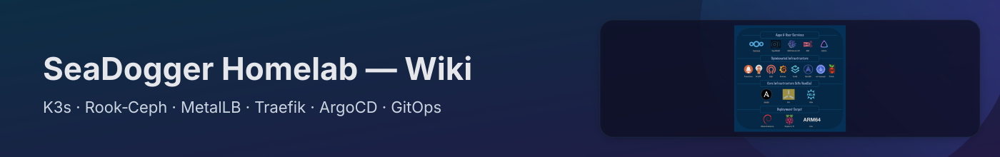

# Networking & Ingress

---
> **🌙 Diagram Viewing Recommendation**
>
> The interactive Mermaid diagrams below are **optimized for GitHub Dark Mode** to provide maximum readability and visual impact.
>
> **To enable Dark Mode:** GitHub Settings → Appearance → Theme → **Dark default**
>
> *Light mode users can still view the diagrams, though colors may appear less vibrant.*
---


## MetalLB Address Pools
> Update to match your subnet.
- `192.168.1.241 - 192.168.1.254`


## Networking
The cluster assumes static node IPs and a dedicated MetalLB pool. If you change the subnet, update the Ansible inventory, MetalLB `IPAddressPool`, and any VIPs referenced in manifests.

Note: Prefer exposing application UIs via Ingress + TLS (cert-manager) at the Traefik VIP. Use direct MetalLB LoadBalancer IPs only where Ingress is not appropriate.


### VIP L2 Advertisements (MetalLB)
| VIP            | Purpose            |
|----------------|--------------------|
| `192.168.1.241` | Traefik (ingress)  |
| `192.168.1.242` | Bedrock Gateway    |
| `192.168.1.250` | Pi-hole DNS        |


### Ingress Hosts (TLS terminates at Traefik `192.168.1.241`) via PiHole DNS
- `openwebui.seadogger-homelab`
- `argocd.seadogger-homelab`
- `ceph.seadogger-homelab`
- `pihole.seadogger-homelab`
- `jellyfin.seadogger-homelab`
- `n8n.seadogger-homelab`


## See Also

- **[[03-Hardware-and-Network]]** - Network topology and IP addressing
- **[[08-Security-and-Certificates]]** - TLS certificates for Traefik
- **[[02-Architecture]]** - C4 Network & Security diagram
- **[[21-Deployment-Dependencies]]** - MetalLB dependency analysis

**Related Issues:**
- [#41 - Centralize subnet config](https://github.com/seadogger-tech/seadogger-homelab/issues/41) - Network configuration management
- [#4 (Pro) - HTTP to HTTPS redirect](https://github.com/seadogger-tech/seadogger-homelab-pro/issues/4) - redirect implementation


### Level 3: Network & Security

Shows traffic flow and TLS encryption paths.

```mermaid
graph TB
    LAN([👤 LAN User])
    VPN([👤 VPN User])

    subgraph UDM["🛡️ Ubiquiti Dream Machine"]
        WG[WireGuard<br/>VPN Server]
    end

    subgraph MetalLB["⚖️ MetalLB"]
        Speaker[Speaker<br/>DaemonSet]
        Controller[Controller<br/>IP Assignment]
        IPPool[IP Pool<br/>192.168.1.241-254]
    end

    subgraph Traefik["🔀 Traefik Ingress"]
        EntryPoint[EntryPoints<br/>:80 :443]
        Router[IngressRoutes<br/>Routing Rules]
        TLSStore[TLS Store<br/>Certificates]
        Redirect[HTTP :80<br/>per-host permanent<br/>HTTPS redirect]
    end

    subgraph CertManager["🔐 cert-manager"]
        CMController[Controller<br/>Issue Certs]
        Issuer[ClusterIssuer<br/>internal-local-issuer]
        RootCA[Root CA<br/>Self-Signed]
        IntermediateCA[Intermediate CA<br/>Signs App Certs]
    end

    subgraph Apps["📦 Applications"]
        Nextcloud[Nextcloud]
    end

    subgraph Encryption["🔐 AWS Encryption"]
        Secret[K8s Secret<br/>aws-credentials]
        BG[Bedrock Gateway<br/>Proxy]
        AWS[AWS Bedrock API]
    end

    LAN -->|HTTPS:443| EntryPoint
    LAN -->|HTTP:80| Redirect
    Redirect -->|308 HTTPS:443| LAN
    VPN -->|WireGuard Tunnel| WG
    WG -->|HTTPS:443| EntryPoint

    Controller --> IPPool
    Speaker --> EntryPoint

    EntryPoint --> Router
    Router --> TLSStore
    Router --> Nextcloud

    CMController --> Issuer
    Issuer --> IntermediateCA
    IntermediateCA --> RootCA
    CMController --> TLSStore

    Apps -->|HTTP Internal| BG
    BG -->|Reads| Secret
    BG -->|HTTPS + TLS 1.3| AWS

    style UDM fill:#1e3a5f,stroke:#4a90e2,stroke-width:3px
    style MetalLB fill:#1e3a5f,stroke:#4a90e2,stroke-width:3px
    style Traefik fill:#1e3a5f,stroke:#4a90e2,stroke-width:3px
    style CertManager fill:#2d5016,stroke:#5a9216,stroke-width:3px
    style Apps fill:#2d5016,stroke:#5a9216,stroke-width:3px
    style Encryption fill:#7b1fa2,stroke:#9c27b0,stroke-width:2px
    style Redirect fill:#2d5016,stroke:#5a9216,stroke-width:2px
```



**Security Features:**
- **External Access:** WireGuard VPN required for remote access
- **TLS Everywhere:** All ingress traffic uses cert-manager certificates
- **AWS Encryption:** Bedrock API calls use TLS 1.3 with AWS credentials from Kubernetes secrets
- **HTTP to HTTPS:** Each application has a `web` IngressRoute that uses a namespace-local `redirectScheme` middleware to send its hostname permanently to port 443. Its `websecure` IngressRoute serves the application with TLS. Requests for unconfigured hostnames do not match an application route.

To check an application from a network that can reach the Traefik VIP, replace the hostname and VIP below. The first response should be `308` with a `Location` header using the same hostname and path on `https://`. Check the HTTPS endpoint separately with a client that trusts the internal root CA.

```bash
curl -sSI --resolve app.example.internal:80:192.0.2.10 http://app.example.internal/example
curl -sSI --resolve app.example.internal:443:192.0.2.10 https://app.example.internal/example
```

The redirect is configured per namespace, so new applications need both the middleware and a `web` IngressRoute alongside their `websecure` route. This does not add HSTS; that is a separate security policy decision.
