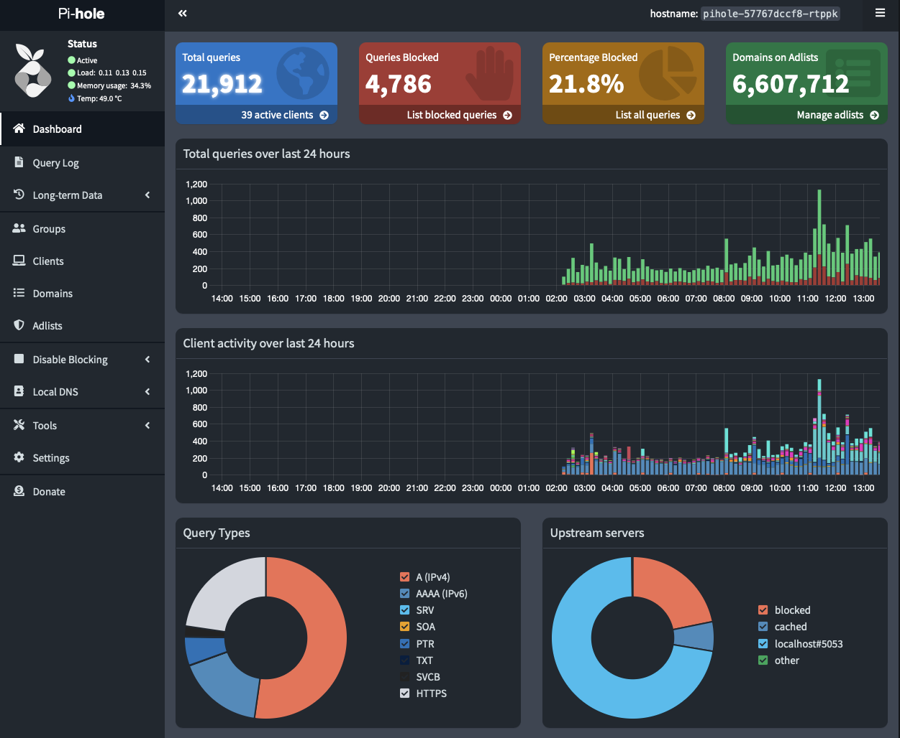
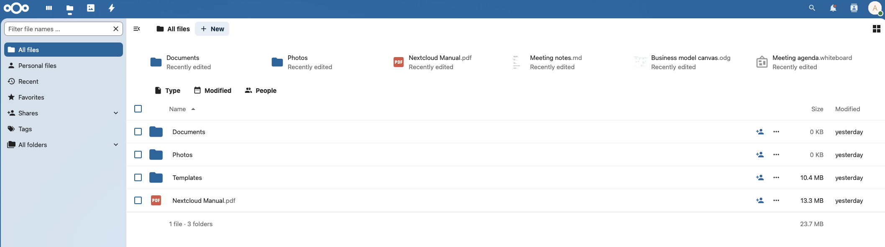
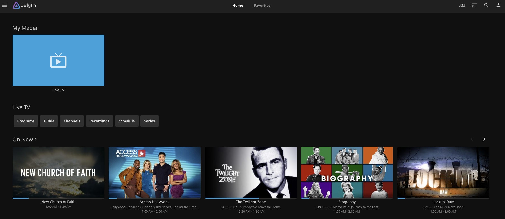

# Applications
User facing applications that are applied thru ArgoCD on top of the k3s tech stack


## PiHole: **Website:** [https://pi-hole.net](https://pi-hole.net)
- Network-wide DNS sinkhole for ads and tracking.
- Blocks ads at the network level (including in-app and smart-TV).
- Web admin interface and API; ideal on Raspberry Pi or any Linux box.
- All `*.seadogger-homelab` hostnames are static `dnsmasq` records defined in
  `core/deployments/pihole/pihole-values.yaml` (`dnsmasq.customDnsEntries`) —
  add a new app's hostname there, not through the Pi-hole UI, so it survives
  a redeploy.
- **Allowlist and adlists in `pihole-values.yaml` are imported only on a
  fresh install** (empty `gravity.db` on the PVC). Changing them restarts the
  pod but leaves the live lists untouched, so apply every change in both
  places: edit the values file, then
  `kubectl -n pihole exec deploy/pihole -c pihole -- pihole allow <domain> --comment "<why>"`.
  Allow-type subscribed lists can't be declared there at all (the chart
  imports `adlists` as block lists); the values file records the one in use
  and the command to restore it.
- **30-Minute Pause button** on the portal calls a small backend
  (`deployments/pihole-toggle`, Pro repo) that holds the Pi-hole admin
  password server-side and calls Pi-hole's v6 API
  (`POST /api/dns/blocking`) — the password never reaches the browser.



## Home Assistant: **Website:** [https://www.home-assistant.io](https://www.home-assistant.io)
- Home automation hub, deployed via the community
  [pajikos/home-assistant-helm-chart](https://github.com/pajikos/home-assistant-helm-chart)
  (`deployments/home-assistant` + `ansible/tasks/ha_deploy.yml`) — chart
  version pinned explicitly.
- **Container mode, no Supervisor:** Core + HACS only. There is no
  add-on store — anything you'd install as a Supervisor add-on
  (Mosquitto, Zigbee2MQTT, ESPHome) needs to run as its own pod instead.
- **No `hostNetwork`, no node-pinning:** standard pod networking, since
  no USB Zigbee/Z-Wave radio is attached. mDNS-based discovery (HomeKit,
  Chromecast, local device auto-discovery) will not work without
  `hostNetwork: true` — revisit if that's ever needed.
- **Reverse-proxy trust required:** HA rejects requests from a reverse
  proxy it doesn't recognize (`400 Bad Request`, "not set-up for reverse
  proxies"). Since we route via our own Traefik `IngressRoute` rather
  than the chart's own `Ingress`, `ingress.external: true` +
  `configuration.enabled: true` in the values file is what makes HA emit
  the `http.use_x_forwarded_for` / `trusted_proxies` config — without it,
  every request 400s.
- **`configuration.yaml` is only regenerated if missing** — the chart's
  init container copies its templated config to the PVC once and never
  again once the file exists. After changing `configuration.templateConfig`
  values, you must delete `/config/configuration.yaml` from the running
  pod and restart it for the new template to actually apply.
- **HACS install:** `wget -O - https://get.hacs.xyz | bash -` run inside
  the pod (`kubectl exec ... -- bash -c "..."`), then restart the pod.
  Not pre-installed by default.
- **Dashboard editing via code:** see **[[17-Runbooks]]** →
  "Edit a Home Assistant Dashboard via Code" for a reusable script
  (`deployments/home-assistant/ha_dashboard_edit.py`) that
  edits Lovelace dashboards through HA's own WebSocket API
  (`lovelace/config` /
  `lovelace/config/save`) instead of hand-editing the live `.storage`
  file.
- **RTSP cameras:** the two Amcrest IP2M-844E cameras (front door, pool)
  are wired in via the core **ONVIF** integration (manual IP entry —
  WS-Discovery/UDP multicast doesn't reach the pod, so auto-discovery
  finds nothing) rather than a standalone go2rtc app. Replaced the old
  `cameras` app (removed; see git history), which was a 2-3fps
  JPEG-polling stopgap.
- Storage: `ceph-block-data` (RBD), single replica — HA's SQLite recorder
  DB needs a single writer.


## Mealie: **Website:** [https://mealie.io](https://mealie.io)
- Self-hosted recipe manager and meal planner
  ([mealie-recipes/mealie](https://github.com/mealie-recipes/mealie)).
- Plain hand-written manifests (`deployments/mealie` +
  `ansible/tasks/mealie_deploy.yml`), not a Helm chart — no third-party
  chart for Mealie has real community adoption, so this follows the
  same self-contained-Kustomize pattern used elsewhere in this repo.
- SQLite backend (default, no separate Postgres needed) on
  `ceph-block-data`, `Recreate` deploy strategy (single writer).
- Stock upstream image `ghcr.io/mealie-recipes/mealie:v3.30.0`, pinned by
  multi-architecture digest in `deployments/mealie/deployment.yaml`.
  Update the release and digest deliberately through a reviewed PR; never use `:latest`.

### Home Assistant Integration
- HA's built-in `mealie` integration (core since 2024.7) connects directly
  to Mealie's API — no HACS plugin needed.
- **Use the in-cluster Service DNS, not the Pi-hole hostname.** HA/Mealie
  pods resolve DNS through k3s's CoreDNS, which has no record for
  `mealie.seadogger-homelab` (that name only exists in Pi-hole's
  `dnsmasq.customDnsEntries`, used by browsers/LAN clients). Configure the
  integration's host as
  `http://mealie.mealie.svc.cluster.local:9000` instead.
- Exposes one `calendar.mealie_<type>` entity per meal-plan entry type
  (breakfast/lunch/dinner/side/snack/drink/dessert) plus stat sensors
  (`sensor.mealie_recipes`, etc.). Calendars stay empty until a recipe is
  assigned to a date in Mealie's **Meal Plan** view.
- The family dashboard's "Today's Meals" card
  (`custom:calendar-card-pro`, `days_to_show: 1`) reads these calendar
  entities directly — one color-coded row per meal type. See
  [Meal-Planning Workflow](#meal-planning-workflow) below.
- HA polls Mealie on its own interval; to force an immediate refresh after
  a manual test, reload the config entry:
  `POST /api/config/config_entries/entry/{entry_id}/reload`.

### AI Features (Recipe Import, Ingredient Parsing)
Mealie's AI provider is configured per group through **Group Settings → AI
Providers** (`/api/groups/ai-providers/*`), not container env vars.

The provider used to point at the in-cluster AWS Bedrock Access Gateway.
That gateway was retired in 2026-11, so AI recipe import and ingredient
parsing do not work until another OpenAI-compatible provider is set in
those group settings. Core Mealie (recipes, meal plans, the Home Assistant
integration) does not depend on it. The provider must support
`response_format: json_schema` structured output; Mealie's client sends it
on every AI request and expects raw JSON back.

#### Custom prompts (runtime configuration)
These files configure the stock upstream container through its prompt override
setting. They do not patch Mealie source or build a custom image.

Custom prompt overrides also live in `deployments/mealie/prompts/recipes/`
and are mounted into the pod via a Kustomize `configMapGenerator`. These
were added when prompt wording was the only lever for clean JSON from the
former Bedrock provider. They are kept so a future provider starts with
the same schema-only instructions:

- ConfigMap `mealie-custom-prompts` mounted at
  `/app/custom-prompts/recipes/` (Mealie expects this exact subdirectory
  — prompt names like `recipes.parse-recipe-ingredients` map to
  `<custom_dir>/recipes/parse-recipe-ingredients.txt`).
- `OPENAI_CUSTOM_PROMPT_DIR=/app/custom-prompts` env var on the Mealie
  deployment tells it to check there first, falling back to Mealie's
  built-in prompts if a file is missing.
- Each of the 4 prompt files (ingredient parsing, image-to-recipe,
  video-to-recipe, URL-scrape) opens and closes with an explicit,
  repeated instruction: *"first character of your response must be `{`,
  no code fences, no `<think>` tags."*
- Kustomize's `configMapGenerator` content-hashes the ConfigMap name, so
  editing a prompt file and re-deploying automatically rolls the Mealie
  pod to pick up the change — no manual restart needed.

#### Meal-Planning Workflow
1. **Add a recipe.** Either **+ Create → Import from URL** (Mealie tries
   its normal scraper first; if the page lacks clean recipe markup, it
   falls back to the group's AI provider when one is configured) or add one by hand.
2. **Assign it to a date.** Mealie → **Meal Plan** → click a date →
   choose an entry type (Breakfast/Lunch/Dinner/etc.) → search/select the
   recipe → Save.
3. **It appears on the dashboard automatically.** HA polls the `mealie`
   integration periodically; the matching `calendar.mealie_<type>` entity
   updates, and the "Today's Meals" card on the family dashboard reflects
   it without any manual step.

#### Forcing the AI Import Path
The former custom Mealie image and its cherry-picked UI changes are retired.
Use the import features supplied by the pinned upstream release. The repository
no longer builds or maintains a separate Force OpenAI Scraper interface.

The retired workflow, patch helpers and build-identity file were removed in
[PR #65](https://github.com/seadogger-tech/seadogger-homelab/pull/65).
The old design remains historical context in
[ADR-011](13-ADR-Index.md#adr-011-adopting-unmerged-upstream-prs-reusable-pattern);
it is not an instruction to restore the custom build.

For upgrades, review the upstream release and migration notes, verify ARM64
support, and update the fixed tag and digest in the deployment manifest.
Preserve a recoverable database backup before a database-changing upgrade.
A rollback must pair the recorded previous image with a compatible database;
changing an image tag alone does not undo database migrations.


## NextCloud: **Website:** [https://nextcloud.com](https://nextcloud.com)
- Open-source, self-hosted content-collaboration and file-sync platform.
- Files & sharing, Office (collaborative editing), Calendar, Contacts, Talk (chat/video).
- Desktop & mobile clients; extensible via a large app ecosystem.


## HDHomeRun Guide Utility

A tiny Python utility that pulls the HDHomeRun XMLTV guide and stores it locally.  
It can be run with:

```bash
# Default (no target, saves to xmltv.xml in current directory)
./fetch_hdhomerun_guide.py \
    --discover-url http://192.168.1.70/discover.json

# Save to a specific location
./fetch_hdhomerun_guide.py \
    --discover-url http://192.168.1.70/discover.json \
    --target /media/data/HomeMedia/files/Live_TV_Guide/xmltv.xml
```

The script lives in `seadogger-homelab-pro/core/useful_scripts/fetch_hdhomerun_guide.py` and is documented in the wiki page **[HDHomeRun Guide Utility](20-HDHomeRun-Guide.md)**.


## Ember Trail
- Family road-trip planner — custom app (`deployments/ember-trail`, Pro
  repo), a small Python state server behind Caddy, not a third-party project.


## JellyFin: **Website:** [https://jellyfin.org](https://jellyfin.org)
- Free, open-source, self-hosted media server.
- Lets you organize and stream movies, TV, music, and photos to many devices.
- Runs on Windows, Linux, macOS, Docker, and more.
- Web UI and apps; supports Live TV/DVR and DLNA.
- Hardware-accelerated transcoding via FFmpeg when available.
- 100% free—no tracking and no premium tiers.



## See Also

- **[[18-Setting-Up-n8n-Connections]]** - N8N configuration guide
- **[[20-HDHomeRun-Guide]]** - Jellyfin live TV setup
- **[[06-Storage-Rook-Ceph]]** - Application storage backends
- **[[08-Security-and-Certificates]]** - Application TLS certificates

**Setup Guides:**
- [#34 - Get passwords](https://github.com/seadogger-tech/seadogger-homelab/issues/34)
- [#35 - PiHole whitelist](https://github.com/seadogger-tech/seadogger-homelab/issues/35)
- [#37 - Jellyfin XMLTV](https://github.com/seadogger-tech/seadogger-homelab/issues/37)
- [#38 - Nextcloud setup](https://github.com/seadogger-tech/seadogger-homelab/issues/38)
- [#39 - N8N workflows](https://github.com/seadogger-tech/seadogger-homelab/issues/39)
