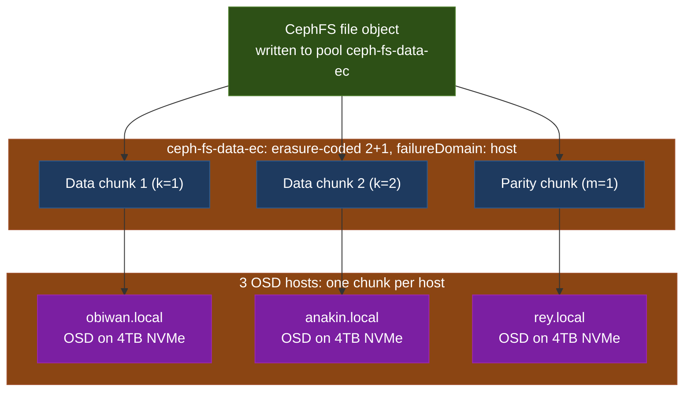

# Design Deep Dives

This page documents detailed technical investigations, problem-solving approaches, and lessons learned from complex deployment challenges.


## Rook-Ceph CephFS with Erasure Coding

### Problem Statement

When deploying CephFS with erasure coding in Rook-Ceph, several critical issues were encountered:

1. **Filesystem creation failed** with "exit status 22"
2. **MDS daemons remained in standby** state instead of becoming active
3. **High PG count warning** exceeded recommended maximum (313 > 250)

### Root Causes & Solutions

#### 1. Erasure Coding Configuration

**Issue:** CephFS requires explicit permission to use erasure coded pools as data pools.

**Root Cause:** By default, CephFS does not allow overwrites on erasure coded pools for safety reasons.

**Solution:**
- Add `force_ec_overwrites: "true"` to the data pool parameters
- Use `--force` flag when creating filesystem manually
- Configure in Rook-Ceph values.yaml:

```yaml
dataPools:
  - parameters:
      force_ec_overwrites: "true"
      allow_ec_overwrites: "true"
```

**Why This Works:** These flags tell CephFS to allow partial overwrites on erasure coded data, which is necessary for filesystem operations but comes with performance trade-offs.

#### 2. PG Count Management

**Issue:** Total PG count exceeded recommended maximum (313 > 250)

**Root Cause:** Too many placement groups for the number of OSDs (3 nodes) causes overhead and performance issues.

**Solution:**
- Reduced `pg_num` from 128 to 64 for the erasure coded data pool
- Keep other pools at lower PG counts (8 for most, 32 for metadata)
- Monitor PG autoscaling progress before proceeding

**Formula Used:**
```
Target PGs per OSD: ~100-200
Total OSDs: 3
Total PGs across all pools: ~150-200 (optimal)
```

#### 3. Pool Naming Convention

**Issue:** Ansible tasks were looking for incorrect pool names

**Root Cause:** Rook-Ceph generates pool names with filesystem name prefix that didn't match expectations.

**Solution:**
- Updated pool name checks in Ansible task:
  - From: `ec-fs-data` or `ec-fs-data0`
  - To: `ec-fs-ec-data`
- Always verify actual pool names with `ceph osd pool ls` before scripting


## Best Practices Learned

### 1. Erasure Coding Setup

**Always enable both flags:**
- `force_ec_overwrites: "true"` - Allows overwrites on EC pool
- `allow_ec_overwrites: "true"` - Permits CephFS to use EC pool
- Place parameters at correct YAML level (under `dataPools[].parameters`)

**Choose appropriate EC profile:**
- **2+1 (used):** Minimum viable, tolerates 1 node failure, ~67% storage efficiency
- **4+2:** Better durability, tolerates 2 node failures, ~67% efficiency
- **8+3:** Large clusters only, ~73% efficiency

With `failureDomain: host`, each of the k+m chunks sits on a different host, so a k+m profile needs at least k+m OSD hosts: 4+2 needs 6 and 8+3 needs 11. This cluster has 3 OSD hosts, so 2+1 is the only profile it can run.

One object in the 2+1 pool is split into two data chunks and one parity chunk, and CRUSH puts each on a different OSD host. Which host holds which chunk varies by placement group; any two of the three chunks are enough to rebuild the object, so no data is lost with one host down.



### 2. PG Management

**Start conservative:**
- Calculate target PGs: `(OSDs × Target PGs per OSD) / Pool Count`
- For 3 OSDs: 32-64 PGs per major pool
- Monitor PG autoscaling with `ceph osd pool autoscale-status`

**Wait for stability:**
- PG autoscaling takes time (minutes to hours)
- Don't proceed with deployments during PG rebalancing
- Use `ceph status` to verify "HEALTH_OK" before continuing

### 3. Deployment Process Order

**Correct sequence:**
1. Deploy Rook-Ceph operator (wait for Ready)
2. Create Ceph cluster (wait for HEALTH_OK)
3. Verify pool creation with `ceph osd pool ls`
4. Check PG counts are stable
5. Create CephFS (MDS pods should become active)
6. Wait for MDS active/standby-replay state
7. Create StorageClass
8. Deploy applications using storage

**Don't skip verification steps** - each layer depends on previous layer health.


## Configuration Example

Complete working configuration for CephFS with erasure coding:

```yaml
cephFileSystems:
  - name: ec-fs
    spec:
      metadataPool:
        replicated:
          size: 3                    # 3× replication for metadata
          requireSafeReplicaSize: true
      dataPools:
        - name: ec-data
          failureDomain: host        # Spread across nodes
          erasureCoded:
            dataChunks: 2            # Data chunks
            codingChunks: 1          # Parity chunks (2+1 profile)
          parameters:
            pg_num: "64"             # Conservative PG count
            allow_ec_overwrites: "true"
            force_ec_overwrites: "true"
            bulk: "true"             # Optimize for large files
      metadataServer:
        activeCount: 1               # One active MDS
        activeStandby: true          # Enable standby-replay for HA
        resources:
          requests:
            cpu: "500m"
            memory: "1Gi"
          limits:
            cpu: "2000m"
            memory: "4Gi"
```


## Troubleshooting Steps

### When Filesystem Creation Fails

1. **Verify pool creation:**
   ```bash
   kubectl exec -n rook-ceph deploy/rook-ceph-tools -- ceph osd pool ls
   ```

2. **Check PG count and health:**
   ```bash
   kubectl exec -n rook-ceph deploy/rook-ceph-tools -- ceph status
   ```

3. **Monitor MDS state:**
   ```bash
   kubectl exec -n rook-ceph deploy/rook-ceph-tools -- ceph fs status
   ```

4. **Review operator logs:**
   ```bash
   kubectl logs -n rook-ceph deploy/rook-ceph-operator --tail=100
   ```

5. **Check EC configuration:**
   ```bash
   kubectl exec -n rook-ceph deploy/rook-ceph-tools -- \
     ceph osd pool get <pool-name> allow_ec_overwrites
   ```

### When MDS Remains in Standby

**Common causes:**
- Pool not properly configured for CephFS
- Missing `force_ec_overwrites` flag
- PG count too high, causing cluster instability
- Insufficient resources for MDS pods

**Resolution:**
```bash
# Manually create filesystem (if needed)
kubectl exec -n rook-ceph deploy/rook-ceph-tools -- \
  ceph fs new ec-fs ec-fs-metadata ec-fs-ec-data --force

# Check MDS logs
kubectl logs -n rook-ceph -l app=rook-ceph-mds --tail=50
```


## Monitoring Points

### Health Checks

```bash
# Overall Ceph health
ceph status

# Filesystem status
ceph fs status ec-fs

# Pool list and parameters
ceph osd pool ls detail

# MDS status
ceph mds stat

# PG autoscaling status
ceph osd pool autoscale-status
```

### Key Metrics

- **MDS state:** Should be "active" or "active/standby-replay"
- **PG count:** Should be stable (not constantly changing)
- **Cluster health:** "HEALTH_OK" (warnings acceptable during operations)
- **OSD status:** All "up" and "in"


## Future Considerations

1. **PG Autoscaling Monitoring**
   - Add automated checks to Ansible tasks
   - Alert on excessive PG count
   - Document safe PG scaling procedures

2. **MDS State Validation**
   - Add health checks for MDS state transitions
   - Implement automated failover testing
   - Monitor MDS performance metrics

3. **Documentation Improvements**
   - Document EC pool requirements in deployment guide
   - Add validation steps for EC configuration
   - Create troubleshooting decision tree

4. **Performance Optimization**
   - Benchmark the 2+1 CephFS pool (`ceph-fs-data-ec`) against the replicated pool (`ceph-fs-data-replicated`)
   - Re-test wider EC profiles only once there are enough OSD hosts: with `failureDomain: host` a k+m profile needs k+m hosts, so 4+2 needs 6 and 6+3 needs 9
   - Optimize for specific workload patterns


## See Also

- [[06-Storage-Rook-Ceph]] - Storage architecture and deployment
- [[12-Troubleshooting]] - General troubleshooting procedures
- [[13-ADR-Index]] - Architecture Decision Records
- [Ceph Erasure Coding Documentation](https://docs.ceph.com/en/latest/rados/operations/erasure-code/)