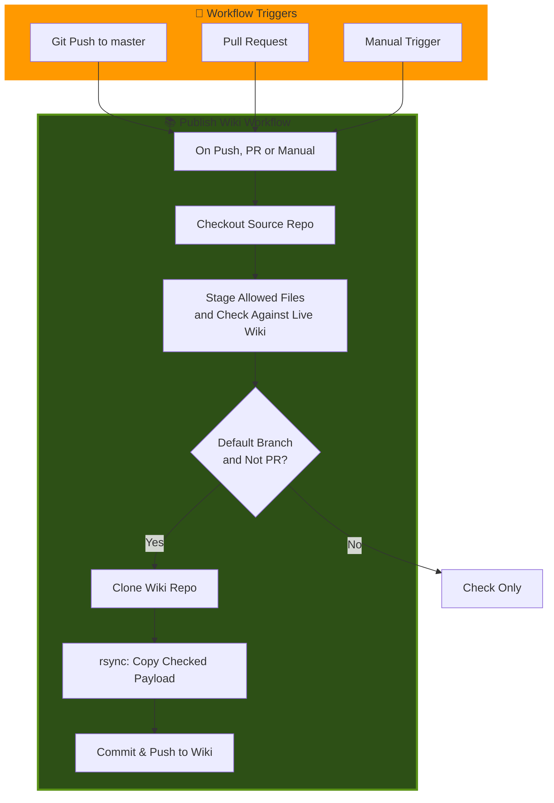
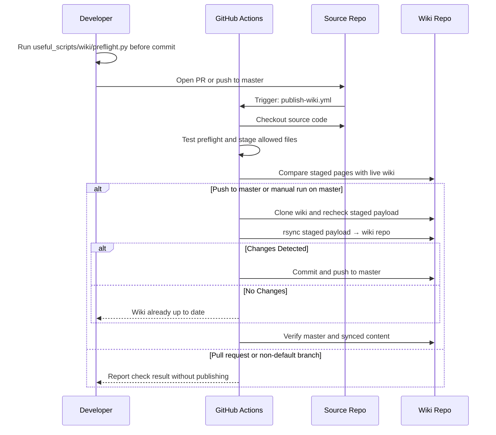

# CI/CD and GitHub Actions

GitHub Actions publishes the wiki, runs repository checks, and builds the Ansible runner image ([[28-Ansible-Runner]]). Mealie is deployed directly from a fixed upstream release pinned by digest; it has no custom image-build pipeline. The Bedrock gateway still uses the adopted-upstream-PR pattern described in [ADR-011](13-ADR-Index.md#adr-011-adopting-unmerged-upstream-prs-reusable-pattern).


---
> **🌙 Diagram Viewing Recommendation**
>
> The interactive Mermaid diagrams below are **optimized for GitHub Dark Mode** to provide maximum readability and visual impact.
>
> **To enable Dark Mode:** GitHub Settings → Appearance → Theme → **Dark default**
>
> *Light mode users can still view the diagrams, though colors may appear less vibrant.*
---

## Overview Diagram




## Publish Wiki Workflow

**Purpose:** Validate the exact public wiki payload on pull requests and pushes, then sync checked-in source from `master` to the GitHub Wiki.

**File Location:** `core/.github/workflows/publish-wiki.yml`

### Workflow Details



### Configuration

**Trigger Events:**
- **Automatic check:** Pull requests and pushes
- **Automatic publish:** Successful check on a push to `master`
- **Manual:** `workflow_dispatch`; publishing only when run on `master`

**Requirements:**
- Check job has `contents: read`; publish job has `contents: write` for its `GITHUB_TOKEN`
- Safety guard: Only runs on `seadogger-tech/seadogger-homelab` repository

**Steps:**
1. **Generate locally if needed** - Run `docs/wiki/tools/build_all.py` in the Core checkout, inspect the diff and commit only reviewed pages. CI does not generate pages.
2. **Run local preflight before committing** - `python3 -B useful_scripts/wiki/preflight.py` from the Core root.
3. **Check in CI** - Checkout source without persisted credentials, test the checker, stage allowed files, and compare their Markdown delta with the live wiki. Pull requests stop here.
4. **Publish from `master`** - Recheck the staged payload against a fresh wiki clone, sync it, then commit and push to wiki `master` if changed.
5. **Verify publication** - Confirm remote `master` and the local wiki copy match the staged payload.

The preflight blocks unclosed fences, large page reductions, personal
checkout paths, account-bearing S3 bucket names, dated evidence headings and
operational result tables.
An intentional large reduction needs a reason and exact old/new content hashes
in `useful_scripts/wiki/publication-exceptions.json`. The automated patterns
catch common mistakes; review other operational details for the public audience
before publishing.

Use the wiki-relative page name as the key. Hash the exact old and new UTF-8
file contents with SHA-256; use `null` for the new hash when deleting a page:

```json
{
  "Page.md": {
    "published_sha256": "OLD_SHA256",
    "source_sha256": "NEW_SHA256_OR_NULL",
    "reason": "Reviewed reason for replacing this page"
  }
}
```

**Files synced:** Root `docs/wiki/*.md` pages, `docs/wiki/memory_bank/**/*.md`, and rendered images under `docs/wiki/images/` with `.png`, `.jpg`, `.jpeg`, or `.svg` extensions. Finder metadata, editable artwork (`images/Logo.key`), and generator scripts (`tools/`) stay in Core. The preflight rejects other unexpected files before sync.


## Mealie Upstream Image

Mealie pulls the stock `ghcr.io/mealie-recipes/mealie:v3.30.0` image,
pinned by the multi-architecture digest in
`deployments/mealie/deployment.yaml`. There is no local build, cherry-pick,
repackaging or push to a Seadogger Mealie image registry.

[PR #65](https://github.com/seadogger-tech/seadogger-homelab/pull/65)
removed the custom Mealie build workflow, its two patch helpers and its
build-identity file. Historical workflow runs and old registry artifacts
do not define the current deployment.

The Mealie ArgoCD Application reads `deployments/mealie` from the Core
repository. Kubernetes pulls the exact upstream digest selected there.
`imagePullPolicy: Always` checks that pinned reference when a pod starts;
it does not select `:latest` or upgrade the chosen version.

To upgrade, open a PR that deliberately changes both the release tag and
digest, verify ARM64 support, and follow the repository's review and deployment
process. Check database migration and recovery requirements before rollout.
Prompt overrides under `deployments/mealie/prompts` are runtime configuration
mounted into the stock image, not a custom image build.


## CI/CD Architecture Diagram

```mermaid
graph LR
    subgraph Developer["👨‍💻 Developer Workflow"]
        EditWiki[Edit docs/wiki/]
        EditMealie[Update pinned Mealie tag and digest]
        Commit[git commit + push]
    end

    subgraph GitHub["🔄 GitHub Actions"]
        WikiAction[publish-wiki.yml]
    end

    subgraph Outputs["📦 Outputs"]
        WikiSite[GitHub Wiki<br/>Updated Docs]
        GHCRMealie[Upstream GHCR<br/>mealie v3.30.0 pinned by digest]
    end

    subgraph Deployment["🚀 Deployment"]
        ArgoCD[ArgoCD]
        K3sCluster[K3s Cluster]
        MealiePod[Mealie Pod]
    end

    EditWiki --> Commit
    EditMealie --> Commit
    Commit -->|Reviewed manifests| ArgoCD
    Commit --> WikiAction

    WikiAction --> WikiSite

    GHCRMealie -->|Pull pinned upstream image| MealiePod
    ArgoCD --> K3sCluster
    K3sCluster --> MealiePod

    style Developer fill:#2d5016,stroke:#5a9216,stroke-width:3px
    style GitHub fill:#1e3a5f,stroke:#4a90e2,stroke-width:3px
    style Outputs fill:#ff9900,stroke:#ff9900,stroke-width:3px
    style Deployment fill:#7b1fa2,stroke:#9c27b0,stroke-width:3px
```




## Key Secrets and Permissions

### Wiki Publisher
- **Token:** `GITHUB_TOKEN` (automatic)
  - Type: Workflow-scoped token (provided by GitHub Actions)
  - Permission: `contents: read` for the check job; `contents: write` for the publish job
  - Target: The wiki's default `master` branch
  - Setup: No repository PAT is required

### Mealie Upstream Pull
Mealie has no build or package-publishing token requirement. The cluster pulls
the selected public upstream image; normal repository credentials govern
manifest changes and ArgoCD reads.


## Adapting/Extending

### Use Wiki Publisher in Another Repo

1. Copy `publish-wiki.yml` to your `.github/workflows/`
2. Update the safety guard condition:
   ```yaml
   if: github.repository == 'your-org/your-repo'
   ```
3. Give the publish job `contents: write` and configure Git with `gh auth setup-git`
4. Update `useful_scripts/wiki/preflight.py` with the destination wiki URL
5. Ensure reviewed wiki content is in `docs/wiki/` and publish to the wiki's default branch

```bash
# View specific run details
gh run view <run-id>

# View run logs
gh run view <run-id> --log

# Check a specific job's step-by-step status while it's still running
# (gh run view --log only works after the run completes)
gh api repos/seadogger-tech/seadogger-homelab/actions/jobs/<job-id> \
  --jq '.steps[] | "\(.name): \(.status) \(.conclusion)"'
```

### Common Issues

**Wiki Publish Fails:**
- **Symptom:** "Authentication failed" error
- **Fix:** Check the workflow's `contents: write` permission and `gh auth setup-git` step
- **Verify:** Inspect the run log and confirm the wiki's default branch advanced

**Wiki Preflight Fails:**
- **Symptom:** The publication-delta check reports a page and line or a large reduction
- **Fix:** Move live evidence to private storage or repair the Markdown structure. For an intentional rewrite, record a reviewed exact-hash exception
- **Verify:** Rerun `python3 -B useful_scripts/wiki/preflight.py` from the Core root

**No Changes Detected:**
- **Symptom:** Workflow runs but commits nothing
- **Expected:** When no actual changes exist in the wiki
- **Action:** No action needed - this is normal behavior


## See Also

- **[[02-Architecture]]** - System architecture showing CI/CD integration
- **[[05-GitOps-and-IaC]]** - ArgoCD deployment workflow
- **[[09-Apps]]** - Mealie and other application details
- **[[13-ADR-Index]]** - ADR-011: the "Adopting Unmerged Upstream PRs" pattern (historical)
- **[[21-Deployment-Dependencies]]** - Understanding deployment order

**Related Issues:**
- [#48 - Pure GitOps Refactor](https://github.com/seadogger-tech/seadogger-homelab/issues/48) - Eliminate deployment dependencies
- [Pro #6 - OAuth2 Improvements](https://github.com/seadogger-tech/seadogger-homelab-pro/issues/6) - Future CI/CD for OAuth credential management
