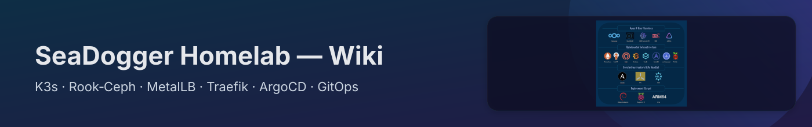

# Pro Overlays and SSO

This page explains what the Pro layer adds on top of the Core stack, and the planned Single Sign-On (SSO) design.

## What Pro Adds Today
Pro deploys with its own playbook (`ansible/main.yml` in the Pro repository), after Core:
- **Portal:** a static launcher for all services (`portal.seadogger-homelab`). Its tiles are gradually moving to the Home Assistant dashboard (ADR-012 in [[13-ADR-Index]]).
- **Velero and Velero UI:** Kopia backups of application volumes to S3 (`velero.seadogger-homelab`); see [[23-Disaster-Recovery-Restore]].
- **Ember Trail:** a small family road-trip planner.
- **Agent tooling:** Paperclip and the MCP servers it uses to operate the cluster, plus a node sensor exporter.
- **Cluster defaults:** namespace `LimitRange` objects.

## Single Sign-On (planned, not deployed)
There is no Keycloak or oauth2-proxy in the cluster today; this is tracked in [Pro #3](https://github.com/seadogger-tech/seadogger-homelab-pro/issues/3). The planned design:
- Keycloak (IdP) for identity and access management
- oauth2-proxy for OIDC integration
- Traefik `ForwardAuth` middleware to enforce SSO at the edge
- Ingress patches/overlays to attach SSO consistently to app UIs

## Hostnames and VIPs
- Traefik VIP: `192.168.1.241`
- Hosts to protect first (examples):
  - `argocd.seadogger-homelab`
  - `ceph.seadogger-homelab`
  - `traefik.seadogger-homelab`

## Deployment Overview (Ansible + ArgoCD)
Pro does not deploy directly with Helm (Velero is the exception: its ArgoCD Application uses the upstream chart). Instead, Ansible applies ArgoCD Applications which point to the relevant charts/manifests and Pro overlays. ArgoCD then reconciles the desired state.

High-level flow:
- Ansible provisions/updates Core (k3s, cert-manager, ArgoCD, MetalLB, storage).
- Ansible applies ArgoCD Application resources for SSO components (e.g., Keycloak, oauth2-proxy) and Pro overlays.
- ArgoCD syncs these apps into the cluster. IngressRoutes reference the Traefik ForwardAuth middleware to enforce SSO.

To deploy:
1) Ensure ArgoCD is installed via the Core playbooks (`argocd_native_deploy.yml`).
2) Apply Pro ArgoCD Application manifests (via your Pro Ansible tasks) that reference:
   - SSO components (charts/manifests)
   - Overlays (kustomize/patches) that attach ForwardAuth to Ingresses
3) Watch ArgoCD sync status and verify protected hosts resolve at Traefik VIP.

## Traefik ForwardAuth Pattern
1) Define a Traefik Middleware pointing to oauth2-proxy (ForwardAuth).
2) Reference the Middleware from each Ingress/IngressRoute that requires SSO.
3) Ensure cert-manager issues TLS for all `*.seadogger-homelab` hosts.

Tips:
- Set correct redirect URIs in Keycloak and oauth2-proxy.
- Use an appropriate cookie domain.
- Verify system time sync to avoid token validation issues.
- Mount internal CA trust where components validate TLS internally.
