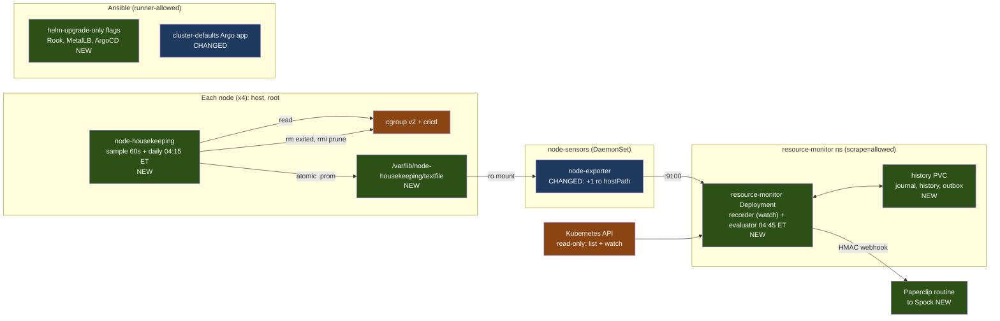
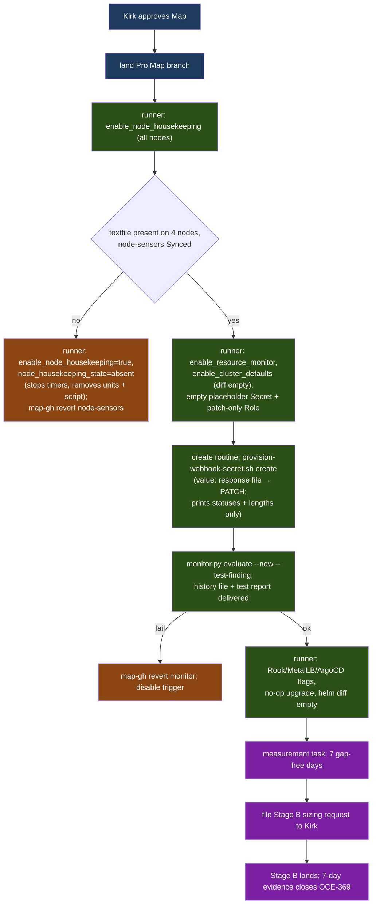
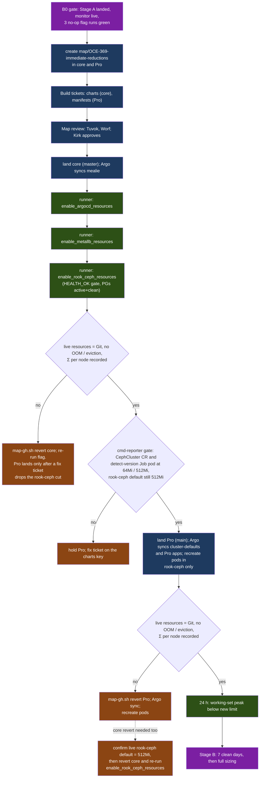
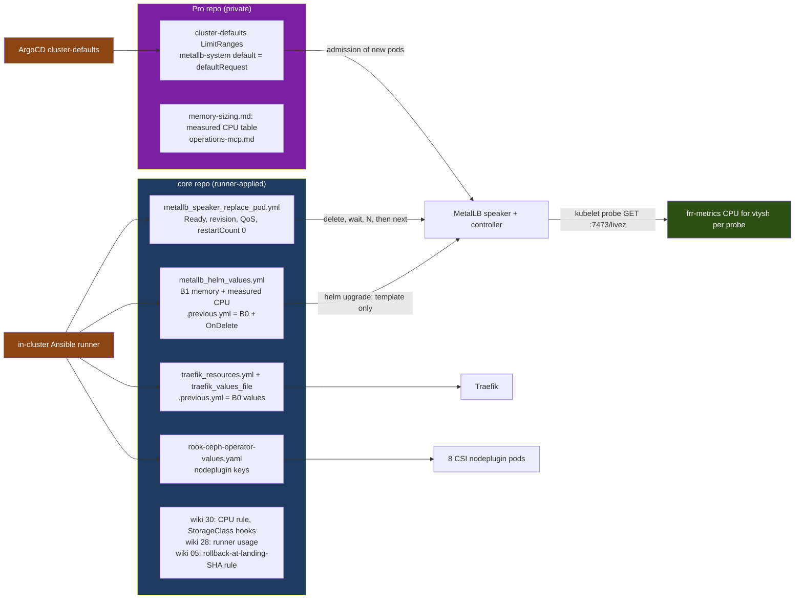
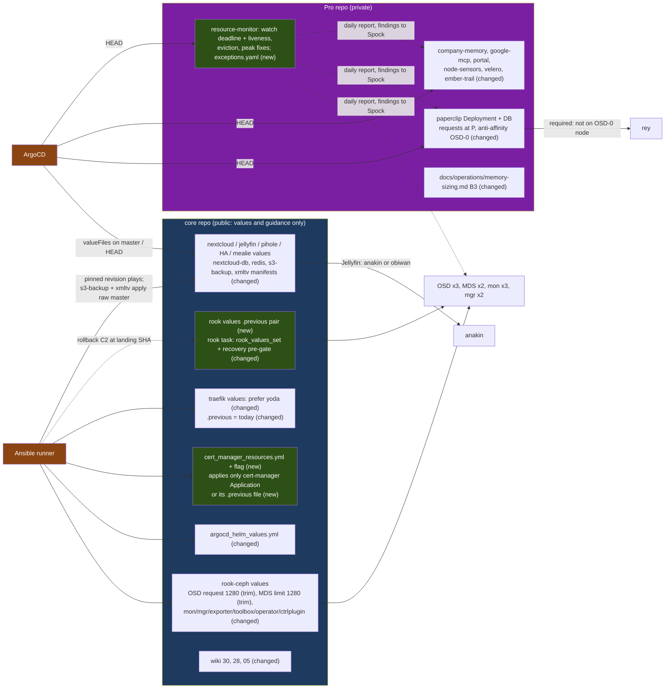

# Cluster Resource Monitor

## Stage B3: placement

### Rey reserved for Paperclip

Every reschedulable core workload except Paperclip has a required placement
rule that excludes `rey.local`. Use `NotIn [rey.local]`, or an `In` allowlist
that omits rey where the workload already has a required host list. These
rules apply on the next pod creation; they do not evict running pods.

The small Rook toolbox, Rook operator and ceph-csi-controller-manager remain
on their existing yoda placements, with memory requests no higher than 168 Mi.
Ceph daemons pinned by device or Git, mgr-b, Paperclip and DaemonSets also
remain exceptions; they are not movable core workloads covered by this rule.

This reserves placement, not N−1 capacity. With requests near node capacity,
loss of an eligible worker can leave a required workload Pending until that
worker returns. No measured P is published in core.

### B3 rollback gates

Run the Rook and cert-manager rollbacks at the re-plan landing SHA `<LAND>`;
run the remaining rollbacks at the Core revert SHA `<REVERT>`. Use the exact
commands in [Ansible Runner](28-Ansible-Runner.md#rollback-revisions). If a
gate refuses or fails, stop before the next step. Do not override a Rook
recovery refusal or revert Core until the failed gate is investigated at the
SHA where it ran.

- **R1 — Rook at `<LAND>`.** Ceph is HEALTH_OK, or the explicit recovery gate
  accepts the state. The run succeeds through the active+clean post-gate;
  both Helm releases use the `.previous` pair; RBD and CephFS ctrlplugin
  Deployments have no node rule and are Ready. Verify B3 sizing remains:
  OSD 1,280/2,928 Mi, mon limit 1,280 Mi, MDS request 1 Gi and limit 1,280
  Mi, and mgr 544/680 Mi. OSD, mon, mgr and MDS pod UIDs and restart counts
  match the prior state, proving no Ceph daemon restarted. If any check fails,
  stop before reverting and investigate at `<LAND>`.
- **R2 — cert-manager at `<LAND>`.** The live Application equals
  `cert-manager-application.previous.yml`, and the webhook admits a test
  Certificate. If either check fails, stop before reverting.
- **R3 — remaining workloads at `<REVERT>`.** Each mover is Ready under its
  rollback placement rule and each Application is Synced/Healthy. Nextcloud
  `status.php` answers, S3 backup reads Git's `0 2 * * *` schedule, Ceph is no
  worse than at the trigger, and no workload is in a restart loop.

### Keep Paperclip off the OSD-0 node

Paperclip stays off the node that runs Ceph OSD-0 and the active MDS. Its agent
processes can use substantial memory at the same time as Ceph needs memory to
serve storage and recover from failures. Separating them protects both the
control plane's work and the storage path.

Paperclip's required pod anti-affinity prevents a newly scheduled Paperclip pod
from sharing a hostname with OSD-0. Its preferred anti-affinity steers it away
from the MDS when another eligible node is available. Kubernetes applies pod
anti-affinity when it schedules a pod; it does not evict an already running pod
if an OSD or MDS later moves onto that node.

Requests sized at observed peaks reserve nearly all worker capacity. That leaves
no N−1 headroom: if a worker goes down, its larger pods can remain Pending until
the worker returns. Placement keeps the workloads separated during normal
operation, but does not make the remaining nodes large enough to absorb a
failed worker.

The cluster resource monitor records node and container measurements before
daily cleanup, preserves short lived containers in history, and reports gaps
that prevent a clean measurement window. Pro owns the host collector and the
resource-monitor application; node-sensors exposes their host textfile metrics
through node-exporter.

## Host housekeeping

Pro Ansible installs the host collector only when the runner is invoked with
`enable_node_housekeeping=true`. The flag defaults to `false`; with it off, the
playbook neither installs nor removes host files.

Each of the four cluster nodes runs `/usr/local/libexec/node-housekeeping` as
root through two systemd timers:

| Timer | Schedule | Work |
|---|---|---|
| `node-housekeeping-sample.timer` | Every 60 seconds (`OnUnitActiveSec=60s`) | Sample each Kubernetes container cgroup and atomically publish container high-water metrics. |
| `node-housekeeping-daily.timer` | 04:15 America/New_York, persistent across downtime | Snapshot exited containers, images and `/` usage, then clean up eligible exited containers and unused images. |

The 04:15 run records the pre-cleanup counts and root filesystem usage first.
It then re-checks each candidate with `crictl inspect` and removes it only if
its state is still exited. It runs `crictl rmi --prune` afterwards. Running or
paused containers are never removed, and kubelet garbage-collection settings
are not changed. Freed bytes are the positive reduction in root filesystem
usage across the cleanup.

The sampler uses each container ID as its lifetime key. Working-set use is
`memory.current - inactive_file`; anon use is read from `memory.stat`. The
working-set and anon high-water values never decrease during that container
lifetime. A restart has a new ID and starts a new high-water record. The
collector caches namespace, pod, pod UID and container identity from
`crictl inspect` labels.

When a cgroup disappears, the last sample that saw it becomes its end
timestamp. The collector retains its identity, high-water values, cgroup
`memory.peak` and `oom_kill` count with `state="ended"` for 14 days. This keeps
short-lived backup Jobs available to the next scrape and lets the monitor join
them to the pod's requests, limits and workload record. A container that lives
and ends between two samples may not have a host record; the monitor reports
that as `peak_unmeasured`.

The sampler stores its previous sample time and cumulative gap counter on
disk. If two consecutive samples are more than 120 seconds apart, the full
interval is added to `node_housekeeping_sampler_gap_seconds_total`, including
intervals that span a reboot. A rise in this counter makes the monitor's
observation window unclean.

The script atomically replaces
`/var/lib/node-housekeeping/textfile/housekeeping.prom` using a temporary file
in the same directory and rename. Node-exporter v1.12.1 reads this host
directory through a read-only `Directory` hostPath mount at `/host-textfile`;
the sensor helper and its in-memory file are unchanged.

### Host metric contract

Per-container series carry `namespace`, `pod`, `pod_uid`, `container`,
`container_id` and `state` labels (`running` or `ended`). End timestamp is
exported for ended containers only.

| Series | Unit | Source and meaning |
|---|---|---|
| `node_housekeeping_exited_containers` | count | Daily count from `crictl ps -a --state exited -q`, before cleanup. |
| `node_housekeeping_images` | count | Daily count from `crictl images -q`, before cleanup. |
| `node_housekeeping_rootfs_used_bytes` | bytes | Used bytes on `/`, before cleanup. |
| `node_housekeeping_rootfs_size_bytes` | bytes | Total bytes on `/`, before cleanup. |
| `node_housekeeping_removed_containers` | count | Exited containers successfully removed after state re-check. |
| `node_housekeeping_removed_images` | count | Images absent after `crictl rmi --prune`. |
| `node_housekeeping_freed_bytes` | bytes | Positive decrease in `/` used bytes across cleanup. |
| `node_housekeeping_container_working_set_peak_bytes` | bytes | 60-second high-water of `memory.current - inactive_file`. |
| `node_housekeeping_container_anon_peak_bytes` | bytes | 60-second high-water of cgroup anon bytes. |
| `node_housekeeping_container_memory_peak_bytes` | bytes | Cgroup `memory.peak`, including page cache. |
| `node_housekeeping_container_oom_kills` | count | Cgroup `memory.events` `oom_kill` value. |
| `node_housekeeping_container_start_timestamp_seconds` | seconds | First sample for the container ID. |
| `node_housekeeping_container_end_timestamp_seconds` | seconds | Last sample that saw an ended container ID. |
| `node_housekeeping_sampler_gap_seconds_total` | seconds | Persistent sum of sampling intervals longer than 120 seconds. |
| `node_housekeeping_last_run_timestamp_seconds{run}` | seconds | Last successful sample or daily run timestamp. |

## Privilege and rollback

The collector runs as root on the host because it reads cgroup files and uses
the local CRI socket for inspection and cleanup. Neither node-sensors
container gains host privilege, capabilities, devices, a service-account token
or RBAC. Node-exporter receives only a read-only mount of the textfile output;
the housekeeping state and CRI socket are not mounted into the pod.

The exact host rollback is a runner run with:

```text
-e enable_node_housekeeping=true -e node_housekeeping_state=absent
```

The absent path stops and disables both timers and their services, removes the
four unit files, reloads systemd, and deletes the installed script,
`housekeeping.prom` and sampler state files. It keeps the empty
`/var/lib/node-housekeeping/state` and
`/var/lib/node-housekeeping/textfile` directories so node-sensors' `Directory`
hostPath remains valid until the DaemonSet mount is reverted. Setting the
enable flag to false is not a rollback.

## Architecture



## The monitor

The monitor is the Pro application `resource-monitor`: one Deployment (one
replica, `Recreate`) in the `resource-monitor` namespace, labelled
`node-sensors-scrape=allowed`. It is a Deployment rather than a CronJob because
the evidence of a deleted Pod or an expired Event only exists while it happens.
One Python script (standard library only, from a ConfigMap) runs two parts that
share the history volume under one `flock`. Its history lives on a 1 Gi PVC at
`/history` (`ceph-block-data`, the cluster's default RBD class), which the
Velero daily schedule includes.

It is applied by the Pro Ansible task `resource_monitor_deploy.yml`, gated by
`enable_resource_monitor` (default `false`). Merging the manifests deploys
nothing by itself.

### The monitor's own access

Stated from `deployments/resource-monitor/` in the Pro repo.

- **Cluster RBAC.** The ClusterRole `resource-monitor` (`rbac.yaml`) is
  cluster-wide and read-only. It allows `get`, `list` and `watch` on `nodes`,
  `pods`, `events`, `apps/replicasets` and `batch/jobs`. It has no write verb,
  no Secret access and no exec. It is bound to the service account
  `resource-monitor:resource-monitor`.
- **Exporter discovery.** The Role `resource-monitor-endpointslice-reader`
  allows `get` and `list` on `discovery.k8s.io/endpointslices` in the
  `node-sensors` namespace only.
- **Network.** `networkpolicy.yaml` allows no ingress. Egress goes only to
  node-sensors pods on 9100, the Kubernetes API server, `paperclip` pods on 3100
  and kube-dns on 53 (UDP and TCP).
- **The API-server rule is pinned to addresses.** It allows `10.43.0.1/32` (the
  Service, port 443) and `192.168.1.95/32` (yoda, port 6443). If the control
  plane moves, or the CNI changes whether it matches before or after the
  Service's address translation, the monitor loses the API with no policy error.
  The visible symptom is a stopped heartbeat and a failing liveness probe. The
  rule to update is the "Kubernetes API server" `ipBlock` entry in
  `networkpolicy.yaml`.

### The recorder and its gaps

The recorder watches Pods and Events in all namespaces with bookmarks and
appends to `/history/journal/YYYY-MM-DD.jsonl` (UTC day), flushing and fsyncing
each batch. It journals only a fixed field list, never a whole object:

- the first sight of each Pod UID: namespace, name, node, owner workload
  (ReplicaSet resolved to its Deployment, Job to its CronJob), QoS class, and
  every container's requests and limits, init containers included;
- every container termination: reason (`OOMKilled` included), exit code,
  started and finished times, restart count;
- Pod evictions and Pod deletions;
- Events with reason `Evicted`, `OOMKilling`, `SystemOOM` or `Preempting`, and
  their counts.

Environment, arguments, annotations and Event or termination messages are never
journaled and never appear in a report.

Every 60 seconds it writes `journal/cursor.json` atomically: each stream's last
`resourceVersion`, each stream's last-alive time and a heartbeat (the older of
the two streams' alive times; see the watch deadline below). A stream's version moves only after the records up to it are fsynced to
the journal, and one lock guards every cursor change and the heartbeat's
snapshot, so a heartbeat during an evaluation can never save a version whose
records are still unwritten. If an append fails, the cursor stays and the watch
retries from the old version, and the record is journaled once. After a dropped
watch or a restart it resumes from the cursor. If the API
answers `410 Gone` it relists and journals a **gap** from the stream's last
alive time to the relist. The first start opens coverage and journals a `start`
record; nothing earlier counts as observed. The liveness probe fails when the
heartbeat is more than 3 minutes old, so a stuck watch restarts the pod and its
gap is recorded.

**The watch deadline and the heartbeat.** The watch asks the server to end it
after `WATCH_TIMEOUT_SECONDS` (300). The socket timeout is that plus
`WATCH_GRACE_SECONDS` (30, never below 1), so 330 s, always above the server's
deadline. A socket timeout below it (the old 90 s) killed every quiet Events
watch before the server did and produced false gaps. When a watch opens, the
stream records its **watch deadline**: the OPEN time plus the socket timeout.
When `cursor.json` is written, a stream counts as alive *now* while its watch is
open and inside that deadline; otherwise it counts as alive at its last OPEN or
event time (a clean server close inside the deadline counts as alive at the
close). The heartbeat is the minimum over the two streams. So a healthy idle
watch, with no events and no bookmarks, keeps the heartbeat fresh until the
server closes it at 300 s and it reopens. A stalled watch (connected, nothing
arriving) ends at its socket deadline and reopens. A stream that cannot reopen,
or a thread stuck past its deadline, stops refreshing, and the probe restarts the
pod when the heartbeat is 180 s old, within its 3 x 30 s failure window. The
probe's 180 s and the healthcheck's `HEARTBEAT_STALE_SECONDS` stay equal.

**When an `events` gap is real.** Kubernetes keeps Events for a TTL (k3s default
1 hour, `EVENT_TTL_SECONDS`). A relist after a blind interval no longer than the
TTL still sees every Event, so the monitor journals no gap for the `events`
stream then. A blind interval longer than the TTL journals exactly one gap. The
`pods` stream has no such cover (a Pod deleted while nobody watched is gone), so
every `pods` relist after a `410 Gone` journals its gap.

### The evaluator

The evaluator runs at 04:45 America/New_York. If the pod was down then, it runs
at start-up as soon as today's history file is missing and it is past 04:45.
`python3 /app/monitor.py evaluate --now [--test-finding]` runs the same
evaluation by hand under the same lock. If today's history file is already
committed, a hand run with `--test-finding` is filed as a *manual* evaluation
under `/history/manual/`; it does not move the day-over-day baseline.

It scrapes `:9100/metrics` on every node-sensors endpoint (found through the
EndpointSlice), lists Nodes (allocatable) and current Pods, reads the journal
since the last evaluation, merges the host's ended containers by container ID
on first sight and joins them by Pod UID and container name to the journal's
requests, limits, QoS and owner. A Pod that is in neither the journal slice nor
the API (it ran yesterday and was deleted today) joins the last recorded
metadata instead: the newest retained history row for that Pod UID and
container, which carries its requests, limits, owner, QoS and node. The pinned image resolves `America/New_York`
through `zoneinfo`; a test asserts it.

### Findings

Each finding has the ID `<type>/<node>/<namespace>/<workload>/<pod>/<container>`
with `-` for any part that does not apply. Two containers breaching the same
metric on one node therefore are two rows.

| Type | Fires when |
|---|---|
| `exited_up`, `disk_up` | A node's exited-container count or root-disk use rose since yesterday, before cleanup. |
| `ratio_over_threshold` | A live container's limit/request is above 1.5, or it has no limit, unless it is a [listed exception](#listed-exceptions) within its `max_ratio`. |
| `peak_over_request` | The working-set high-water mark is above the request. Ended containers are checked once, when first merged. |
| `peak_unmeasured` | The journal shows a container that ran for at least one host sampling interval (60 s), but no host record overlaps its run. Runs of a CronJob or Job are counted per family: one finding per CronJob (or Job) and container, with the number of unmeasured runs, not one per Pod. A run shorter than the sampling interval can be missed legitimately and is never flagged, and neither is a container that ended before the first evaluation (before the evaluation window, or on the first evaluation before the recorder's own `start`). |
| `besteffort` | A live Pod has QoS BestEffort. |
| `node_overcommitted` | The sum of Pod memory limits on a node is above its allocatable memory. |
| `evicted`, `oom_killed` | From the journal (Pod status, terminations, Events) and from the host's `oom_kill` counts, ended containers included. One incident seen by several sources is one finding that lists every source (`journal`, `host`, `event`, `api`). An eviction is counted once, in the evaluation that first sees it: the finding carries the Pod UID, and once an earlier history file has a finding for that UID, no source (journal, Event or API) raises another, so the incident leaves the 7-day window with its first day. The window counts distinct Pod UIDs. |
| `collector_stale` | A node has no scrape, its `daily` timestamp is missing or over 26 h old, or its `sample` timestamp is over 10 min old. |
| `observation_gap` | A journal gap, a rise in `node_housekeeping_sampler_gap_seconds_total`, a stale collector, or a missed evaluation day. |
| `delivery_backlog` | A report part has been pending for more than 24 h. |
| `exception_stale` | A row of the exceptions file matches no live container. Reported once, in the evaluation that first finds it stale. |
| `test_finding` | Added only by `--test-finding`. |

A container that restarts gets a new container ID and a fresh peak, so a lower
peak under a new ID is reported as a restart, never as a drop. Day-over-day
change is shown only between the same container ID on consecutive days.

### Listed exceptions

Some containers are over 1.5x on purpose (the Ceph OSD and mon, the Velero
node-agent, the k3s-bundled pods that cannot be changed through Git). They are
listed in `deployments/resource-monitor/exceptions.yaml` in Pro, mounted
read-only at `/etc/resource-monitor/exceptions.yaml` from the same ConfigMap as
the values map. The monitor image has no YAML library, so the file is a flat
list in exactly this shape (one value per line, no folded text):

```yaml
exceptions:
  - namespace: example-ns          # fnmatch glob
    workload: example-workload     # glob; the Pod's top owner (Deployment, StatefulSet, DaemonSet, CronJob)
    container: example-container   # glob
    max_ratio: 2.0                 # number: the listed limit/request
    reason: One line a reviewer can check
```

A live container that matches a row and whose limit/request is at or under
`max_ratio` appears in the daily report under **Listed exceptions**, not as a
`ratio_over_threshold` finding. Above `max_ratio`, or with no limit at all, it
is still a finding and says which max it broke. Listed exceptions never start a
report on their own: they ride along when a report is sent for something else. A
row that matches no live container is reported once as `exception_stale`. A
malformed file is logged and ignored, which turns every listed container back
into a finding.

To add a row, a reviewer copies the block above into `exceptions.yaml`, takes
namespace, workload and container from the finding id
(`ratio_over_threshold/<node>/<namespace>/<workload>/<pod>/<container>`), sets
`max_ratio` just above today's ratio, writes the reason, and merges it through
the Pro repo. The ConfigMap name carries a hash, so the Deployment rolls.

### Window status

Every history file records the trailing 7 days: distinct evicted Pod count, OOM count and
the list of observation gaps (a missing day inside the window counts as a gap).
`clean` is true only when all three are empty. A gap makes `clean` false even
with zero evictions and zero OOM kills, because nothing can be concluded about
an interval nobody watched. `days_with_history` says how much of the window
exists at all.

### Proposal rule

`ratio_over_threshold` and `peak_over_request` findings carry the 1.25x values:
request = the working-set high-water mark rounded up to the next 16 Mi, limit =
1.25 x request. A 1000 Mi high-water mark proposes request 1008Mi and limit
1260Mi. Each also names where the value lives (an ArgoCD values file, a
manifest or an Ansible task), from the static map in the
`resource-monitor-values` ConfigMap. The monitor never edits a live object;
Spock turns a proposal into a Build ticket or small task.

### History and retention

`/history/YYYY-MM-DD.json` holds, per node and per container (running, ended
and init), every metric in the host contract plus requests, limits, allocatable,
limit/request ratio, QoS and owner workload, the journal's terminations,
evictions, Events and gaps, the findings, the window status, `evaluated_through`
and the rendered report parts. Journal files, history files and delivered
report parts are kept 400 days. The history file's rename is the evaluation's
only commit (see below).

### The aggregate report and its finding IDs

An evaluation with at least one finding produces one report, keyed
`[resource-monitor/<YYYY-MM-DD>]`, that lists every finding with its ID,
numbers, day-over-day change, proposal and whether it is new since yesterday.
A report over 32 KiB is split into parts (`[resource-monitor/<date> 2/3]`);
every finding appears in exactly one part. Paperclip's webhook body limit is
10 MB, so 32 KiB is the smaller bound and is the split size.

The payload is JSON: `{"date", "key", "part", "parts", "report"}`. The routine
that receives it must declare one text variable named `report` and put
`{{report}}` in its description, because Paperclip copies top-level payload
fields into routine variables and shows them in the run issue (an
`hmac_sha256` trigger does not append the raw payload to the issue). The key
leads the report text.

### Commit, outbox and duplicates

```text
journal (fsynced) + host samples + API  ->  evaluate  ->  render parts in memory
   ->  write /history/<date>.json with the parts embedded
       (temp file, fsync, rename, fsync of /history)   <- the COMMIT
   ->  reconcile: embedded parts in neither outbox/pending nor outbox/delivered
       are written to outbox/pending from the saved bytes
   ->  deliver every pending part, oldest first, byte for byte
       2xx: rename into outbox/delivered      otherwise: stays pending
```

- **Crash before the commit:** no history file exists. Start-up catch-up
  re-evaluates from the previous file's `evaluated_through`. Its inputs are
  durable (the fsynced journal and the host's 14-day ended-container records),
  so an incident that has since resolved is found again. Stray temp files are
  deleted at start-up.
- **Crash after the commit:** the evaluation is never recomputed. Reconcile
  rebuilds any part missing from the outbox from the saved bytes, never from
  current conditions. It runs at start-up, right after each commit and before
  every delivery pass, and never rewrites a part already in either directory.
- A part moves absent, then `pending`, then `delivered`, only by atomic rename.
- Each delivery tries 3 times with backoff on a timeout or non-2xx. Only a 2xx
  acknowledges it. The recorder process retries pending parts every hour. A
  resent part is the same bytes, so a condition that resolved overnight cannot
  erase it.
- After an ambiguous timeout the same part may arrive twice (each attempt has a
  fresh timestamp, so Paperclip's replay guard does not drop it). Duplicates are
  accepted: close all but one run issue.

The request is `POST` to the trigger's `.../fire` URL with `Host: localhost`,
`X-Paperclip-Timestamp` (epoch seconds) and `X-Paperclip-Signature`, the hex
HMAC-SHA256 of `"<timestamp>." + <raw body>` under the trigger's secret. That is
exactly what Paperclip's routine webhook verifies, inside a 300 second replay
window.

### Webhook Secret: provisioning and rotation

The Secret `resource-monitor-webhook` (keys `url`, `secret`) is mounted
read-only as a volume without `subPath`, so a rotation reaches the pod. It is
not in Git. `resource_monitor_deploy.yml` creates it with both keys empty only
if it is absent and never overwrites an existing one. The monitor re-reads both
files before each delivery pass. With a key empty it logs `webhook not
configured` and leaves its parts pending. At start-up and on any change it logs
`webhook config: url len=<n> secret len=<m>`: lengths, never values.

`resource-monitor-webhook-writer` is the only write path: a Role granting
`patch` on that one Secret by name, bound to `paperclip:default` (the account the
Paperclip pod runs as). The account cannot `get`, `list`, `watch`, `create` or
`delete`. It can still read this one Secret back: a Kubernetes PATCH response
returns the whole object, so an empty merge-patch `{}` returns `data.url` and
`data.secret`. Every agent process in the Paperclip pod holds that account. This
is an accepted trade-off: the read-back reaches only principals already inside
the Paperclip pod, and the value is Paperclip's own trigger secret.
`provision-webhook-secret.sh` deliberately sends the Kubernetes response to
`/dev/null`.

**Rule:** no `kubectl patch`, MCP patch or other PATCH that prints its response
may target `resource-monitor-webhook`, because that output contains the value.

`deployments/resource-monitor/provision-webhook-secret.sh` (POSIX `sh`, `curl`,
`jq`) is the only way the value is handled:

```text
provision-webhook-secret.sh create <routineId>    # adds the hmac_sha256 trigger, replayWindowSec 300
provision-webhook-secret.sh rotate <triggerId>    # rotates the secret
```

It refuses to run with `xtrace`, sets `umask 077`, writes Paperclip's response
only to a temp file that a trap removes, and pipes a `jq`-built merge patch from
that file straight into the Kubernetes PATCH. The value is never an argument, a
variable or output. It prints only HTTP statuses, the trigger ID, key paths on a
malformed response, and the URL and secret lengths. A non-2xx or a missing or
empty field exits 1 before anything is written.

**Verify with lengths only:** the script prints two 2xx statuses and
`url len=<n> secret len=<m>`; the monitor's `webhook config` line must show the
same lengths. Then run `python3 /app/monitor.py evaluate --now --test-finding`
once in the pod. The report reaching Spock and moving to `outbox/delivered`
proves the value end to end. Never read the Secret back: no `kubectl get
secret`, no Kubernetes MCP read.

**Rotate on any exposure.** If the value ever appears in a transcript, log,
comment, tool argument or any file other than the response temp file and the
Secret, run `rotate <triggerId>` at once (Paperclip invalidates the old value
immediately), then record on the ticket that it happened, without the value.

### Sequence

```mermaid
sequenceDiagram
  participant S as sampler (60s, host)
  participant D as daily timer 04:15 ET (host)
  participant N as node-sensors
  participant R as recorder (watch)
  participant E as evaluator 04:45 ET
  participant K as Kubernetes API
  participant H as history PVC
  participant P as Paperclip routine
  loop every 60 s
    S->>S: read cgroups, update working-set/anon high-water
    S->>S: cgroup gone: mark ended, keep 14 days; count gaps over 120 s
    S->>N: rewrite housekeeping.prom (atomic, running + ended)
  end
  K-->>R: watch Pods + Events (resume from cursor)
  R->>H: append journal (specs, terminations, evictions, Events), fsync
  R->>H: cursor + heartbeat every 60 s
  alt 410 Gone or restart without a valid cursor
    R->>K: relist
    R->>H: journal gap (stream, from heartbeat, to relist)
  end
  D->>D: snapshot exited, images, disk, peaks
  D->>D: crictl rm (re-checked exited), rmi --prune
  D->>N: housekeeping.prom (snapshot + removed + timestamp)
  E->>N: GET :9100/metrics (each node)
  E->>K: list nodes, pods
  E->>H: read yesterday, journal since last run, outbox
  E->>E: merge ended containers, join specs, compute findings, window status, proposals
  E->>E: render report parts (key + exact payload bytes)
  E->>H: COMMIT: write today's history file with parts embedded (temp, fsync, rename)
  Note over E,H: crash before commit: catch-up re-evaluates from previous evaluated_through.<br/>crash after commit: never recomputed, reconcile rebuilds parts from the file.
  E->>H: reconcile (also at start-up and hourly): each embedded part in neither pending nor delivered is written to outbox/pending from the saved bytes (temp, fsync, rename)
  loop each pending part, oldest first (also hourly from the recorder)
    E->>P: POST fire (HMAC, Host: localhost), up to 3 tries
    alt 2xx
      P-->>E: run issue for Spock
      E->>H: move part to outbox/delivered
    else timeout or non-2xx
      E->>H: part stays pending, resent unchanged next time
    end
  end
```

### Rollout and rollback



Roll the monitor back by reverting its Pro commit (Argo prunes the app) and
disabling the routine's trigger. The history PVC keeps its data until it is
deleted on purpose.

### Tests

`deployments/resource-monitor/tests/` in Pro runs in CI (`python3 -m unittest
discover -s deployments/resource-monitor/tests`): fixture metrics and API JSON
against a stub receiver for findings, proposal maths, delivery, crash recovery
(a test-only environment hook exits the process at a named point), the 410
resume, secret hygiene, the rendered manifests and the provisioning script.

## Stage B0 immediate reductions

Stage B0 of OCE-369 cuts limits (and over-sized requests) in the charts the
Ansible runner applies, plus mealie, using memory peaks that already prove
the cut is safe. **No request goes up**, so no pod can go Pending and no
node's reservation rises. Stage B (after seven clean monitor days) does the
full 1.25× sizing. The Pro half (LimitRanges and Pro manifests) is a separate
Map ticket and lands after this one.

### Per-container table

`P` is the largest cgroup v2 `memory.peak` among the containers one chart key
sets: the larger of the OCE-550 snapshot and the live re-read of 2026-11-25
19:29:53Z–19:30:24Z (OCE-600 document `peak-reread`), over each container's
lifetime. `Live P` is the re-read alone; no P changed. `memory.peak` includes page cache, so it is an upper bound on
working set. Rule: request′ = min(request, ⌈P⌉₁₆) with a 32Mi floor;
limit′ = max(⌈1.25 × request′⌉₈, ⌈1.25 × P⌉₈) with a 40Mi floor; applied only
when below today's limit. Values are Mi. CPU is unchanged. The same numbers
are the fixture `ansible/tests/b0_memory_peaks.yml`, which
`ansible/tests/test_b0_memory_reductions.py` checks against the changed files
(limit ≤ old limit, request ≤ old request, limit ≥ 1.25 × P).

| Container | Request (now → B0) | Limit (now → B0) | P | Live P | Window | Request below P |
|---|---|---|---|---|---|---|
| log-collector (x10) | 100 → 32 | 1024 → 40 | 26.5 | 26.5 | 2.22 d |  |
| ceph-exporter (x3) | 50 → 48 | 128 → 64 | 33.1 | 33.1 | 10.28 d |  |
| rook-ceph-tools | 64 → 64 | 256 → 136 | 105.6 | 105.6 | 27.68 d | yes |
| csi-rbdplugin | 64 → 64 | 1024 → 128 | 102.2 | 102.2 | 25.05 d | yes |
| csi-rbdplugin driver-registrar | 64 → 32 | 512 → 40 | 24.3 | 18.0 | 25.05 d |  |
| csi-rbdplugin liveness-prometheus | 32 → 32 | 256 → 48 | 37.9 | 37.9 | 25.05 d | yes |
| csi-cephfsplugin | 64 → 64 | 1024 → 144 | 110.4 | 110.4 | 25.05 d | yes |
| csi-cephfsplugin driver-registrar | 64 → 32 | 512 → 40 | 24.3 | 24.3 | 25.05 d |  |
| csi-cephfsplugin liveness-prometheus | 32 → 32 | 256 → 48 | 37.9 | 37.7 | 25.05 d | yes |
| metallb speaker | 128 → 80 | 512 → 104 | 68.1 | 68.1 | 7.47 d |  |
| metallb frr | 32 → 32 | 256 → 64 | 50.2 | 50.2 | 7.48 d | yes |
| metallb reloader | 32 → 32 | 256 → 64 | 45.3 | 45.2 | 25.04 d | yes |
| metallb frr-metrics | 32 → 32 | 256 → 48 | 32.3 | 32.3 | 25.04 d | yes |
| metallb controller | 96 → 96 | 512 → 152 | 120.4 | 120.4 | 25.73 d | yes |
| argocd application-controller | 384 → 384 | 1024 → 792 | 631.5 | 631.5 | 25.23 d | yes |
| argocd repo-server | 64 → 64 | 1024 → 408 | 321 | 321.0 | 15.72 d | yes |
| argocd server | 64 → 64 | 1024 → 184 | 146.5 | 146.5 | 25.04 d | yes |
| argocd dex-server | 64 → 64 | 1024 → 160 | 124.2 | 124.2 | 25.23 d | yes |
| argocd notifications-controller | 64 → 64 | 1024 → 88 | 69.7 | 69.7 | 25.73 d | yes |
| argocd applicationset-controller | 64 → 64 | 1024 → 80 | 63.5 | 63.5 | 25.23 d |  |
| argocd redis | 64 → 32 | 1024 → 40 | 15.4 | 15.4 | 25.73 d |  |
| mealie | 320 → 320 | 1024 → 408 | 325.5 | 325.5 | 20.67 d | yes |

Notes:

- `log-collector` (10 sidecars on mon, mgr, OSD and MDS pods) and
  `ceph-exporter` are set together by one key each; the figure is the largest
  peak among them. The shortest `log-collector` window at the live read is
  2.22 d (mds-b); the key qualifies through the containers over 7 d.
- `memory.events` `max` and `oom_kill` are 0 for every container of every key
  at the live read, and none of those containers restarted since OCE-550.
- The rbd `driver-registrar` P of 24.3 is above its live 18.0 (likely the
  cephfs registrar's figure). It stays at 24.3: conservative, and the 40Mi
  limit floor applies either way.
- `csi-*plugin` requests are written at the live 64Mi, not the repo's old
  128Mi, per the `ROOK_USE_CSI_OPERATOR` note in the operator values. The
  operator copies the node plugin request into the controller plugin, so the
  controller's live 128Mi request also falls to 64Mi (its peak is 57.4Mi).
  Nothing rises. The CSI Driver CRs are rendered by the operator at runtime, so
  `helm template` cannot show them; after `enable_rook_ceph_resources`, read the
  Driver CR and confirm the request did not rise. If the operator ignores a
  key, record it here and leave that container to Stage B.
  **Correction (Stage B1):** the nodeplugin rows (`csi-*plugin`, `driver-registrar`,
  `liveness-prometheus`) were not delivered by B0; they are delivered by B1
  through the `csi*ProvisionerResource` keys. The `csi*PluginResource` keys B0
  edited reach only the controller plugin Driver CR, and Rook 1.18 reads the
  node plugin and registrar from the other pair (see *Stage B1*).
- `cmd-reporter` is a new key on the CephCluster CR at 64Mi request / 512Mi
  limit, today's effective values from the `rook-ceph` LimitRange `default`
  (512Mi). It has no measured peak: it is set explicitly so the Pro cut of
  that default cannot reach the detect-version and network Jobs.
- MetalLB `frr-metrics` is 48Mi, not the spec's indicative 40Mi: 40Mi is
  below 1.25 × its 32.3Mi peak.
- Σ over the containers B0 touches, per node (Mi, before → after;
  from the OCE-550 snapshot, not a live read): anakin requests 894 → 576,
  limits 8064 → 912; obiwan 1058 → 672, 10112 → 1136; rey 1822 → 1344,
  15232 → 2376; yoda 1440 → 1200, 10752 → 2264. B0 does not make the nodes
  fit: Σ limits stays above allocatable on every node until Stage B.

### Left for Stage B

| Containers | Reason |
|---|---|
| Ceph mon, mgr, OSD, MDS daemons | App budgets tied to the limit; the OSDs are already at their limit. Stage B sets the pins. |
| Paperclip, `oce-git-sync`, paperclip-db | Critical; windows under 2 days; no node has room. |
| Velero server and node-agents | Data-mover path; the server is at its limit. |
| Traefik | Not delivered by B0; delivered by B1 through the HelmChartConfig (Guaranteed at ≥ 256Mi, see *Stage B1*). |
| company-memory, rook-ceph-operator | At their limit: they need a raise, not a cut. |
| Home Assistant | 1.25 × P is above today's 2048Mi limit. |
| pihole, cloudflared, portal, mgr `watch-active` | Windows under 7 days. |
| Nextcloud (app, cron, db, redis), Jellyfin (app, xmltv-proxy) | Values sit inline in `nextcloud_deploy.yml` / `jellyfin_deploy.yml`; whether the runner may run those stages is unverified. |
| coredns, metrics-server, local-path-provisioner | k3s-bundled manifests: the k3s path is outside the runner. |
| Every container whose request stays below P | Needs a request raise, which needs Stage B's per-node budget table. |

### Rollout, verification and rollback

Core lands first. Argo syncs mealie from core `HEAD`. Then the runner applies
`enable_argocd_resources`, `enable_metallb_resources` and
`enable_rook_ceph_resources` (HEALTH_OK gate; all PGs `active+clean`). Before
Pro lands, the `cmd-reporter` gate must pass live: the CephCluster CR
`spec.resources.cmd-reporter` and a `rook-ceph-detect-version` Job pod both
read 64Mi request / 512Mi limit while the `rook-ceph` LimitRange `default` is
still 512Mi. Run it outside 02:00–04:45 America/New_York, with no agent build
in progress (a MetalLB speaker roll can move the Paperclip LB IP briefly).

**Rollback order.** The `cmd-reporter` key stays live for as long as the
`rook-ceph` LimitRange `default` is below 512Mi. Reverting Pro alone is always
safe, because it raises the default. Removing the key (reverting core's
landing, or any later change to `rook-ceph-cluster-values.yaml` that drops it)
waits for this sequence: (a) revert the Pro `rook-ceph` LimitRange cut and let
Argo sync; (b) read the live LimitRange and confirm the `rook-ceph` `default`
memory is 512Mi again, recording it on the task; (c) only then revert core and
re-run `enable_rook_ceph_resources`. An OOM kill or eviction of a B0-changed
container sends that key back to its previous values as a fix ticket.



## Stage B1: Guaranteed QoS for the network path and CSI nodeplugin limits

Stage B1 of OCE-369 finishes what B0 could not deliver without a capacity decision: the
CSI nodeplugin limits, Guaranteed QoS for MetalLB and Traefik, and a gated way to replace
the MetalLB speakers. It adds no measured value to this wiki. The per-container table
(`P`, old → new, ratio), the per-node totals and every rollout receipt are in the private
Pro `docs/operations/memory-sizing.md`; this section holds only the rule, the keys and
how to check them, with placeholder values (`<P>`, `<request>`, `<limit>`).

*Delivered by B1 through these paths:* the nodeplugin rows B0 listed (not delivered by B0)
through `csi*ProvisionerResource` in `deployments/rook-ceph/rook-ceph-operator-values.yaml`;
the operations-mcp row (not delivered by B0, whose reduced value never reached the
cluster because its Application is pinned to a reviewed revision) through the Pro pin
advance; Traefik through the HelmChartConfig below.

### Sizing rule

`P` is the larger of a container's working-set peak and its cgroup `memory.peak`, read
live at build time and taken as the maximum over all replicas on all nodes.

- **Burstable:** request = `P` rounded up to 8Mi; limit = 1.25 × request, rounded up to 8Mi.
- **Guaranteed:** request = limit = 1.25 × `P`, rounded up to 8Mi, and CPU request = CPU
  limit. A pod is Guaranteed only when **every** container, init containers included, has
  request = limit for memory and CPU.
- No request is below `P` and no limit rises above the one it replaces.
- **The 1.5× exception.** The two CSI plugin containers (`csi-rbdplugin`,
  `csi-cephfsplugin`) get limit = 1.5 × request. An OOM kill of a plugin breaks every
  mount on its node, and its mount work scales with the number of volumes, which no
  observation window bounds. No other container uses the exception.
- **Init containers.** The MetalLB chart has no values for the speaker's `cp-frr-files`,
  `cp-reloader` and `cp-metrics`; they take the namespace LimitRange defaults. The
  `metallb-system` LimitRange must have `default` = `defaultRequest` (memory and CPU) before a
  speaker is recreated, or the pod stays Burstable. LimitRanges apply only at pod
  admission, so a changed default reaches a speaker only when it is recreated.

### CPU rule for Guaranteed containers

Let `P` be the 100 ms CFS period, `L` the CPU limit, and `C` the probe handler's CPU cost.
The quota is `L × P` per period, so the handler finishes within
`(ceil(C ÷ (L × P)) + 1) × P` in the worst phase. CPU request = limit = the largest of the
limit that makes this bound ≤ 0.4 × the probe timeout (400 ms for a 1 s timeout), startup CPU
divided by 10 seconds, or four times mean steady use. For a 1 s timeout, the probe term is
`L ≥ C ÷ 300 ms`; for example, `frr-metrics` `/livez` at about 80 ms of CPU, measured
2026-11-26, gives `L ≥ 267m`,
rounded up to 275m. Round up the final limit to 25m. Measure live with cgroup `cpu.stat`,
process `utime`/`stime` and child `cutime`/`cstime`, and wall time from `/proc/uptime`;
time the call from a different container in the pod (for example, `frr`), because a client
inside `frr-metrics` spends that cgroup's own quota. Values in the table remain placeholders;
the measured table belongs in the private Pro sizing record and its ticket.

Every MetalLB speaker must be `Guaranteed`. There is no `Burstable` fallback: if any node's
CPU request budget does not fit, stop before rollout and return the sizing decision to design.
The `frr-metrics` container needs CPU for the FRR probe path: every `/livez` call forks
`vtysh`, and that CPU is charged to `frr-metrics`, even though the probe checks `frr`.

| Container | Request = limit |
|---|---:|
| `frr-metrics` | `<CPU>` (at least 275m) |
| `frr` | `<CPU>` (at least 125m) |
| `reloader` | `<CPU>` (at least 125m) |
| `speaker` | `<CPU>` (at least 100m) |
| `controller` | `<CPU>` (at least 50m) |

### Where each key lives

| Component | Where Git sets it | What the live object shows |
|---|---|---|
| CSI nodeplugin (plugin, registrar, liveness) | `csi.csiRBDProvisionerResource` and `csi.csiCephFSProvisionerResource` in `deployments/rook-ceph/rook-ceph-operator-values.yaml`; entries named `csi-*plugin`, `driver-registrar` and `liveness-prometheus` | Driver CR `spec.nodePlugin.resources.{plugin,registrar,liveness}` and the nodeplugin DaemonSet pods |
| CSI controller plugin | `csi.csiRBDPluginResource` and `csi.csiCephFSPluginResource` (unchanged by B1) | Driver CR `spec.controllerPlugin.resources` |
| MetalLB speaker and sidecars | `speaker.resources`, `speaker.frr.resources`, `speaker.reloader.resources`, `speaker.frrMetrics.resources` in `ansible/vars/metallb_helm_values.yml` | speaker DaemonSet pods |
| MetalLB controller | `controller.resources` in the same file | controller Deployment pod |
| Traefik | `resources` in `ansible/vars/traefik_helmchartconfig_values.yml` (both the cold-start dashboard task and `enable_traefik_resources` render it into the HelmChartConfig `kube-system/traefik`) | Traefik Deployment pod |

**Rook 1.18 reads the CSI keys crossed.** With `ROOK_USE_CSI_OPERATOR`, the operator writes
`csi.ceph.io/v1` `Driver` CRs on every start (`createOrUpdateRBDDriverResource` and its
CephFS twin in `pkg/operator/ceph/csi/operator_driver.go`, v1.18.1). Their
`spec.nodePlugin.resources` come from `createDriverNodePluginResouces(<driver>ProvisionerResource)`,
which keeps the entries whose names contain `registrar`, `plugin`, `liveness` or `addons`; their
`spec.controllerPlugin.resources` come from the `*PluginResource` key. So the node plugin is
sized by the `*ProvisionerResource` entries, and the `csi-provisioner`, `csi-resizer`,
`csi-attacher` and `csi-snapshotter` entries in that key do nothing. A hand patch of a Driver CR
does not survive an operator restart, so it is never a path. `helm template` shows the keys in
the operator ConfigMap (`CSI_RBD_PROVISIONER_RESOURCE`, `CSI_CEPHFS_PROVISIONER_RESOURCE`) but
not the Driver CRs, which the operator renders at runtime.

### Why MetalLB speakers use OnDelete and a gated loop

`RollingUpdate` moves to the next speaker as soon as the new pod is available, and
`metallb_resources.yml` is one `helm upgrade --atomic --wait` with no step between pods. A speaker
that cannot announce its Services is an outage for everything behind a `LoadBalancer`, DNS
included. So the shared values set `speaker.updateStrategy: {type: OnDelete}` (the chart key at
0.15.2). `helm upgrade` then changes the template and the controller Deployment and replaces
no speaker, and `ansible/tasks/metallb_speaker_replace.yml` (included by `metallb_resources.yml`
after the upgrade; `kubectl` and `uri` only) replaces them:

1. The target revision is the hash of the speaker DaemonSet's highest-numbered ControllerRevision.
   The stale pods are the speakers off that revision, or every speaker with `metallb_speaker_replace=all`.
2. The network check **N** (retried for about 90 s): every `LoadBalancer` Service has an ingress IP,
   each has exactly one `ServiceL2Status` whose node runs a Ready speaker, and the Traefik
   `LoadBalancer` IP answers HTTP with any status.
3. **N** runs once before the first deletion. If it fails, nothing is deleted.
4. For each stale pod, in node-name order: delete it; wait up to 180 s for the replacement on the
   same node (Ready, at the target revision, `qosClass` = `metallb_speaker_expect_qos`, with each
   init container's admitted resources in the output); run **N**. The first failure ends the play,
   naming the pod, before the next deletion.
5. Post-check: `updatedNumberScheduled` = `numberReady` = `desiredNumberScheduled`.

`metallb_speaker_expect_qos` defaults to `Guaranteed`; a rollback to Burstable values passes
`Burstable`. A native redeploy (`metallb_native_deploy.yml`) over running speakers replaces none of
them; `enable_metallb_resources` replaces them through this loop. On a fresh install `OnDelete` only
governs later template changes.

**The Helm waiter.** Helm 3's `--wait` counts a DaemonSet whose strategy is not `RollingUpdate`
as ready (`pkg/kube/ready.go`, `daemonSetReady`), so the upgrade returns. Helm 4's default waiter
counts updated pods, would wait for speakers that only the loop replaces, time out, and
`--atomic` would roll the release back. `metallb_resources.yml` therefore reads
`helm version --short` on the control node, prints it, and passes `--wait=legacy
--rollback-on-failure` on Helm 4 or later and `--wait --atomic` on Helm 3.

Under the `enable_rook_ceph_resources` flag, the Rook Ceph 1.18.1 chart renders StorageClasses
as `post-install,pre-upgrade` hooks with `before-hook-creation` deletion policy and
`resource-policy: keep`. Each Helm upgrade therefore deletes and recreates the class, allowing
immutable parameters to change. Bound PVs do not depend on the StorageClass object; its
`reclaimPolicy` and default-class annotation come from the values. A PVC created during the
brief hook gap waits until the class is recreated.



### Rollback values

`ansible/vars/metallb_helm_values.previous.yml` holds the B0 values plus `speaker.updateStrategy: OnDelete`.
`metallb_values_file=metallb_helm_values.previous.yml` selects it; no other file name is accepted.
For a core rollback, run `enable_metallb_resources` at the core landing SHA with
`-e metallb_values_file=metallb_helm_values.previous.yml -e metallb_speaker_expect_qos=Burstable` only if
the MetalLB step ran. R5 returns the template to B0, rolls back the controller Deployment, and the gated
loop replaces the speakers the forward run replaced, one at a time. After R5's gate passes when R5 ran,
or directly when the MetalLB step did not run, run R5b on every core rollback at the core landing SHA:
`enable_traefik_resources` with
`-e traefik_values_file=traefik_helmchartconfig_values.previous.yml`. R5b passes only when its Job
succeeds, the live HelmChartConfig deep-equals `.previous.yml`, Traefik is Ready at the B0 resources and
`Burstable`, and its LoadBalancer IP answers HTTP. If either R5 or R5b fails its gate, stop before the
core revert: the revert removes `traefik_values_file`. Only after the applicable R5 gate and the R5b gate
pass, revert core (R6). At the revert SHA, R7 runs only the Rook flag and, if the MetalLB step ran, the
MetalLB flag; it no longer runs the Traefik flag.

## Stage B3: fit the four nodes

Stage B3 sizes the remaining runner-applied charts and workloads from live
working-set peaks. This page keeps the rule and mechanisms; the measured P,
per-node sums and rollout receipts belong on the Paperclip tickets and in the
private Pro `docs/operations/memory-sizing.md`. Numbers in the tables below are
placeholders, not measurements.

### Sizing rule

`P` is the highest `node_housekeeping_container_working_set_peak_bytes` for a
container over the sampler window, across every replica and node. Re-read it at
build time. If OCE-550 or OCE-551 recorded a higher long-window working-set
peak, that is the floor. B3 does not use `memory.peak`: for the large
containers it is mostly reclaimable page cache.

- Change a container only when its limit/request ratio is above 1.25 or P is
  above its request. Leave values already within the rule alone; keep B1 values.
- For a regular container, request = P rounded up to 8Mi and limit = 1.25 ×
  request rounded up to 8Mi.
- For an app with an internal memory budget, request = max(P, budget) rounded
  up to 8Mi; limit = 1.25 × request rounded up to 8Mi. This covers Nextcloud
  PHP `memory_limit`, Redis `maxmemory`, and Nextcloud Postgres settings.
- Init containers take their main container's resources. ArgoCD `copyutil` and
  the Velero plugin init are explicit so their admitted limits do not hold the
  pod above its main container.
- Below 64Mi, 8Mi rounding can produce ratios up to 1.5× (for example 16/24).
  This is an explicit rounding exception.

| B3 row | Request / limit (Mi) |
|---|---:|
| OSD | `<request>` / `<limit>` |
| MDS | `<request>` / `<limit>` |
| mon, mgr, `mgr-sidecar`, exporter, toolbox, operator | `<request>` / `<limit>` per container |
| CSI controller plugins and liveness | `<request>` / `<limit>` per container |
| ArgoCD components and copyutil | `<request>` / `<limit>` per container |
| cert-manager, cainjector, webhook | `<request>` / `<limit>` per container |
| ansible-runner and checkout init | `<request>` / `<limit>` per container |
| Traefik | `<request>` / `<limit>` (resources unchanged in B3) |

### §3.4 exceptions

The exceptions are recorded in the monitor's Git-held exceptions list and are
described here without measured P values:

| Container | Exception and reason |
|---|---|
| Ceph OSD | Ratio is above 1.5×. The request is deliberately the `osd_memory_target`, not P: Rook passes `POD_MEMORY_REQUEST` to Ceph as `--osd-memory-target`, so raising the request to P would grow the BlueStore cache. The limit is 1.25 × live P. The OSD remains system-node-critical and is evicted last. |
| Ceph mon | Ratio is above 1.5× because `mon_memory_target` (1Gi) floors its limit. The target is in the Ceph config DB and has no GitOps path; current evidence does not show that lowering it is safe. |
| Velero node-agent | Ratio is above 1.5×. Kopia streams whole volumes and has no memory knob; the weekly 13-hour Nextcloud backup falls outside the sampler window. |
| coredns, metrics-server, local-path-provisioner | Ratios are above 1.5× and deferred because their `.skip` files on yoda block k3s from upgrading these manifests. |
| Paperclip and paperclip-db | Their higher ratios protect concurrent agent runs and Postgres's observed worst-case memory; Postgres was OOM-killed at 1Gi. |
| Jellyfin app | ffmpeg transcode use scales with concurrent streams, which the sampling window does not bound. |
| Kopia maintenance Job | The Nextcloud repository grows each Sunday; its first maintenance after a weekly backup is outside the window. |
| CSI nodeplugin `rook-ceph.*.csi.ceph.com-nodeplugin` | B1's 1.5× allowance prevents an OOM from breaking every mount on that node. |
| Containers under 64Mi | 8Mi rounding can produce a ratio up to 1.5×. |
| MDS standby, Nextcloud and Redis / Nextcloud DB | Their requests may exceed P: standby-replay must be sized to take over the active rank, while the application requests include their internal memory budgets. |

### Ceph mechanisms and chart paths

For the OSD, `cephClusterSpec.resources.osd.requests.memory` is the cache
target. B3 sets it to `<request>`; Rook passes it into Ceph as
`--osd-memory-target`. The separate OSD limit is `<limit>` from live P and
provides headroom for non-cache allocations. Do not infer an OSD request from
P.

For MDS, the Rook limit is `<limit>` and Rook derives
`mds_cache_memory_limit` as 0.5 × that limit (`<cache-limit>`). B3 does not
change the global MDS cache config. The `mon_memory_target` also stays as set.

Rook 1.18.1 crosses the CSI resource keys: `csiRBDPluginResource` and
`csiCephFSPluginResource` render `Driver.spec.controllerPlugin.resources`;
`csiRBDProvisionerResource` and `csiCephFSProvisionerResource` render the
nodeplugin resources. B3 changes only the controller-plugin entries
`csi-rbdplugin`, `csi-cephfsplugin` and `liveness-prometheus`. The
`csi-provisioner`, `csi-resizer`, `csi-attacher`, `csi-snapshotter` and all
nodeplugin values stay as they are.

The Rook operator's v1.19.2 chart has no supported affinity value (it exposes
nodeSelector and tolerations only), so B3 leaves operator placement unchanged.
Toolbox, Traefik and all cert-manager components prefer yoda; the operator
placement request for obiwan is not represented in the chart.

### B3 delivery map



### B3 rollout and rollback

```mermaid
flowchart TD
  A["Kirk approves Merge to main"] --> P["record prior state (private)"]
  P --> L1["land core; hard refresh valueFiles apps"]
  L1 --> C1{"C1: apps at B3 values; Jellyfin Pending only?"}
  C1 -- no --> RC
  C1 -- yes --> R1["runner: rook (wait for operator reconcile)"]
  R1 --> D1C{"D1 Ceph: HEALTH_OK, PGs clean, targets set,<br/>MDS active + standby-replay, no cache/slow-op warning 15 min?"}
  D1C -- no --> RC
  D1C -- yes --> R2["runner: argocd, cert-manager, traefik, pinned plays (key check passed)"]
  R2 --> D1R{"D1 rest: Synced/Healthy, webhook admits,<br/>Traefik answers, plays at B3 values?"}
  D1R -- no --> RC
  D1R -- yes --> D2{"D2: rey room for Paperclip + 128,<br/>anakin fits JF + DB, no other run live?"}
  D2 -- no --> HOLD["Pro not landed; post numbers; re-plan"]
  D2 -- yes --> L2["land Pro (Paperclip restart ends this run)"]
  L2 --> D3{"D3: Paperclip Ready on rey, DB Ready,<br/>Jellyfin on anakin, Pro apps Healthy?"}
  D3 -- no --> RP["Pro rollback P1"]
  RP --> Q{"core also failing?"}
  Q -- yes --> RC
  Q -- no --> OKP["prior Pro state restored"]
  D3 -- yes --> V{"per-node requests fit, no BestEffort,<br/>no OOM/eviction, report clean?"}
  V -- no --> RP
  V -- yes --> CL["Production, Retro, closing Gist: met / not met"]
  RC["core rollback: C1 git revert; hard refresh"] --> CG{"Ceph HEALTH_OK?"}
  CG -- yes --> C2R["C2 at landing SHA: rook_values_set=previous"]
  CG -- no --> RG{"recovery pre-gate: not HEALTH_ERR,<br/>only listed codes, at most 1 OSD down?"}
  RG -- no --> STOP
  RG -- yes --> C2X["C2 at landing SHA: rook previous + rook_recovery"]
  C2R & C2X --> C2O["C2: argocd + pinned plays at revert SHA;<br/>cert-manager and Traefik .previous at landing SHA"]
  C2O --> RAW{"raw master serves revert blob<br/>(s3-backup, xmltv manifests)?"}
  RAW -- "not yet: wait, re-check" --> RAW
  RAW -- yes --> C2A["C2.6 at revert SHA: s3-backup, xmltv plays<br/>(only those run at rollout)"]
  C2A --> RCG{"C3: prior record matches (Ceph targets, pods,<br/>cert-manager App + Deployments, Traefik,<br/>db/redis pins, s3-backup CronJob, xmltv Deployment),<br/>HEALTH_OK in 30 min, mounts, webhook admits, xmltv Ready?"}
  RCG -- yes --> OKC["prior core state restored"]
  RCG -- no --> STOP["stop; investigate; post on the Map"]
  style A fill:#1e3a5f,color:#fff
  style R1 fill:#8b4513,color:#fff
  style R2 fill:#8b4513,color:#fff
  style L2 fill:#7b1fa2,color:#fff
  style CL fill:#2d5016,color:#fff
  style RC fill:#8b4513,color:#fff
  style C2R fill:#8b4513,color:#fff
  style C2X fill:#8b4513,color:#fff
  style C2O fill:#8b4513,color:#fff
  style C2A fill:#8b4513,color:#fff
  style RP fill:#8b4513,color:#fff
  style OKC fill:#2d5016,color:#fff
  style OKP fill:#2d5016,color:#fff
  style STOP fill:#8b4513,color:#fff
```



The core revert changes the MetalLB strategy back to `RollingUpdate`, which is not part of the pod
template, so it replaces no speaker. To go back to B0 for the speakers while keeping the rest of B1,
run the shared values with `-e metallb_speaker_replace=all -e metallb_speaker_expect_qos=Burstable`
after the `metallb-system` LimitRange is back at its B0 value; this is R3, with core staying at B1.
Rollback is complete when every other object matches the prior-state record and Traefik matches B0 using
the `.previous.yml` values. A revert alone does not count, because pods admitted under a changed
LimitRange keep their values until they are recreated. Each later change to the shared MetalLB values
replaces the `previous` file with its own prior values.

```mermaid
flowchart TD
  A["Kirk approves Merge to main"] --> P["step 2: record prior state + cpu.stat (private)<br/>Traefik record = D1 evidence, not rollback target"]
  P --> B["land core"] --> C["runner: Rook and Traefik at landing SHA"]
  C --> D1{"D1: failed=0, HEALTH_OK, mounts, Traefik live = Git?"}
  D1 -- "no: core rollback; step 5 has not run" --> R5b
  D1 -- yes --> E["land Pro: cluster-defaults syncs"]
  E --> D2{"D2: LimitRange = Pro main?"}
  D2 -- no --> RP["Pro rollback: R1 revert Pro"]
  D2 -- yes --> F["runner: MetalLB upgrade + gated loop, expect Guaranteed"]
  F --> F1{"Ready, target revision, Guaranteed, restartCount 0, N passes?"}
  F1 -- "no: named stop; no further deletion" --> RP
  F1 -- yes --> D3{"D3: all speakers clean; 10 x /livez < 400 ms; IPs announced?"}
  D3 -- no --> RP
  D3 -- yes --> G["runner (Pro): operations-mcp pin advance"]
  G --> D4{"D4: targetRevision = sync.revision = SHA, Healthy?"}
  D4 -- no --> RP
  D4 -- yes --> V{"step 8: Guaranteed, no OOM/eviction, values live?"}
  V -- no --> RP
  V -- yes --> H["Gist on OCE-706; OCE-369 resumes"]
  RP --> R2{"R2: live LimitRange = prior record?"}
  R2 -- "no: stop and fix the sync" --> STOP["stop: leave remaining state untouched; record and investigate"]
  R2 -- yes --> R4["R4: restore operations-mcp pin (if step 7 ran)"]
  R4 --> Q{"core also reverting?"}
  Q -- no --> R3["R3 (if step 5 ran): replace=all, expect Burstable"]
  R3 --> R3G{"Job succeeded?"}
  R3G -- "no: stop at named pod" --> STOP
  R3G -- yes --> OK["rollback complete"]
  Q -- yes --> S5{"step 5 ran?"}
  S5 -- yes --> R5["R5: MetalLB .previous at landing SHA, Burstable"]
  R5 --> R5G{"Job succeeded? record speaker UIDs and hashes"}
  R5G -- "no: stop at named pod" --> STOP
  R5G -- yes --> R5b
  S5 -- no --> R5b["R5b: Traefik .previous at landing SHA"]
  R5b --> R5bG{"Job succeeded; config = .previous; Traefik Ready, B0, Burstable; HTTP?"}
  R5bG -- "no: do not revert core" --> STOP
  R5bG -- yes --> R6["R6: revert core"]
  R6 --> R7["R7 at revert SHA: Rook (+ MetalLB strategy if step 5 ran)"]
  R7 --> R7G{"speaker UIDs unchanged; strategy = prior record?"}
  R7G -- no --> RN["record it; run N"] --> R8
  R7G -- yes --> R8{"R8: prior record matches; Traefik = B0 target?"}
  R8 -- yes --> OK
  R8 -- "no: record mismatch as a fix ticket" --> STOP
  style A fill:#1e3a5f,color:#fff
  style C fill:#8b4513,color:#fff
  style E fill:#7b1fa2,color:#fff
  style G fill:#7b1fa2,color:#fff
  style H fill:#2d5016,color:#fff
  style RP fill:#8b4513,color:#fff
  style R5b fill:#8b4513,color:#fff
  style R6 fill:#1e3a5f,color:#fff
  style STOP fill:#8b4513,color:#fff
  style OK fill:#2d5016,color:#fff
```



### Traefik

The k3s HelmChartConfig `kube-system/traefik` carries `resources` with request = limit for memory and CPU
(memory not below the Guaranteed 256Mi floor, because a Go process holds its heap to `GOMEMLIMIT`,
which should equal the container limit). `enable_traefik_resources` (see [Ansible Runner](28-Ansible-Runner.md))
writes only that object. `enable_traefik_dashboard` is neither a destructive nor a derived flag for
`guard.py`, and its task writes only the dashboard IngressRoute and the HelmChartConfig, but it is an
untagged task in a play that also runs other applications, so the narrow flag is the one to run.

### Verify on a live cluster

Values below are placeholders.

```bash
# CSI nodeplugin: the Driver CRs (read-only) and the pods they produce
kubectl -n rook-ceph get driver.csi.ceph.io -o jsonpath='{range .items[*]}{.metadata.name}{" "}{.spec.nodePlugin.resources}{"\n"}{end}'
kubectl -n rook-ceph get pods -l app=csi-rbdplugin -o jsonpath='{range .items[*]}{.metadata.name}{" "}{range .spec.containers[*]}{.name}={.resources.requests.memory}/{.resources.limits.memory} {end}{"\n"}{end}'
# MetalLB and Traefik: admitted resources and QoS, init containers included
kubectl -n metallb-system get pods -o jsonpath='{range .items[*]}{.metadata.name}{" "}{.status.qosClass}{"\n"}{end}'
kubectl -n metallb-system get pod <speaker> -o jsonpath='{range .spec.initContainers[*]}{.name}={.resources}{"\n"}{end}'
kubectl -n kube-system get pod -l app.kubernetes.io/name=traefik -o jsonpath='{.items[0].status.qosClass}{"\n"}'
# gate state: strategy and revision of the speaker DaemonSet, announced Services
kubectl -n metallb-system get ds metallb-speaker -o jsonpath='{.spec.updateStrategy.type}{" "}{.status.updatedNumberScheduled}/{.status.numberReady}/{.status.desiredNumberScheduled}{"\n"}'
kubectl -n metallb-system get servicel2statuses.metallb.io
```

Each Guaranteed pod shows `Guaranteed`; each nodeplugin pod shows `<request>/<limit>` for its plugin,
registrar and liveness containers, and the Driver CR shows the same values.

### Tests

`ansible/tests/test_b1_memory_values.py` asserts the B1 values (request = limit for every MetalLB
container and the Traefik HelmChartConfig, the rule against the peaks recorded in the B0 fixture, the
nodeplugin keys, and the operator ConfigMap render when `helm` is present).
`ansible/tests/test_metallb_speaker_replace.py` runs the loop for real on localhost against a stub
`kubectl` that serves canned JSON and logs deletions: all checks pass (one deletion per stale pod, in
order); **N** fails after the first replacement (the play fails with exactly one deletion); the pre-check
fails (no deletion); a replacement at the wrong `qosClass` (no second deletion); and unknown values fail.
