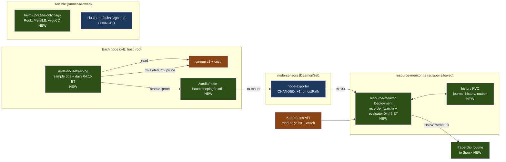
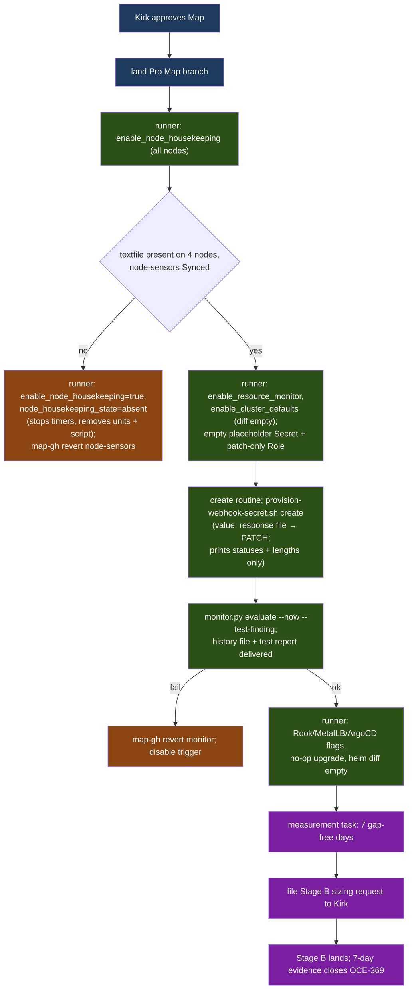

# Cluster Resource Monitor

The cluster resource monitor records node and container measurements before
daily cleanup, preserves short lived containers in history, and reports gaps
that prevent a clean measurement window. Pro owns the host collector and the
resource-monitor application; node-sensors exposes their host textfile metrics
through node-exporter.

## Host housekeeping

Pro Ansible installs the host collector only when the runner is invoked with
`enable_node_housekeeping=true`. The flag defaults to `false`; with it off, the
playbook neither installs nor removes host files.

Each of the four cluster nodes runs `/usr/local/libexec/node-housekeeping` as
root through two systemd timers:

| Timer | Schedule | Work |
|---|---|---|
| `node-housekeeping-sample.timer` | Every 60 seconds (`OnUnitActiveSec=60s`) | Sample each Kubernetes container cgroup and atomically publish container high-water metrics. |
| `node-housekeeping-daily.timer` | 04:15 America/New_York, persistent across downtime | Snapshot exited containers, images and `/` usage, then clean up eligible exited containers and unused images. |

The 04:15 run records the pre-cleanup counts and root filesystem usage first.
It then re-checks each candidate with `crictl inspect` and removes it only if
its state is still exited. It runs `crictl rmi --prune` afterwards. Running or
paused containers are never removed, and kubelet garbage-collection settings
are not changed. Freed bytes are the positive reduction in root filesystem
usage across the cleanup.

The sampler uses each container ID as its lifetime key. Working-set use is
`memory.current - inactive_file`; anon use is read from `memory.stat`. The
working-set and anon high-water values never decrease during that container
lifetime. A restart has a new ID and starts a new high-water record. The
collector caches namespace, pod, pod UID and container identity from
`crictl inspect` labels.

When a cgroup disappears, the last sample that saw it becomes its end
timestamp. The collector retains its identity, high-water values, cgroup
`memory.peak` and `oom_kill` count with `state="ended"` for 14 days. This keeps
short-lived backup Jobs available to the next scrape and lets the monitor join
them to the pod's requests, limits and workload record. A container that lives
and ends between two samples may not have a host record; the monitor reports
that as `peak_unmeasured`.

The sampler stores its previous sample time and cumulative gap counter on
disk. If two consecutive samples are more than 120 seconds apart, the full
interval is added to `node_housekeeping_sampler_gap_seconds_total`, including
intervals that span a reboot. A rise in this counter makes the monitor's
observation window unclean.

The script atomically replaces
`/var/lib/node-housekeeping/textfile/housekeeping.prom` using a temporary file
in the same directory and rename. Node-exporter v1.12.1 reads this host
directory through a read-only `Directory` hostPath mount at `/host-textfile`;
the sensor helper and its in-memory file are unchanged.

### Host metric contract

Per-container series carry `namespace`, `pod`, `pod_uid`, `container`,
`container_id` and `state` labels (`running` or `ended`). End timestamp is
exported for ended containers only.

| Series | Unit | Source and meaning |
|---|---|---|
| `node_housekeeping_exited_containers` | count | Daily count from `crictl ps -a --state exited -q`, before cleanup. |
| `node_housekeeping_images` | count | Daily count from `crictl images -q`, before cleanup. |
| `node_housekeeping_rootfs_used_bytes` | bytes | Used bytes on `/`, before cleanup. |
| `node_housekeeping_rootfs_size_bytes` | bytes | Total bytes on `/`, before cleanup. |
| `node_housekeeping_removed_containers` | count | Exited containers successfully removed after state re-check. |
| `node_housekeeping_removed_images` | count | Images absent after `crictl rmi --prune`. |
| `node_housekeeping_freed_bytes` | bytes | Positive decrease in `/` used bytes across cleanup. |
| `node_housekeeping_container_working_set_peak_bytes` | bytes | 60-second high-water of `memory.current - inactive_file`. |
| `node_housekeeping_container_anon_peak_bytes` | bytes | 60-second high-water of cgroup anon bytes. |
| `node_housekeeping_container_memory_peak_bytes` | bytes | Cgroup `memory.peak`, including page cache. |
| `node_housekeeping_container_oom_kills` | count | Cgroup `memory.events` `oom_kill` value. |
| `node_housekeeping_container_start_timestamp_seconds` | seconds | First sample for the container ID. |
| `node_housekeeping_container_end_timestamp_seconds` | seconds | Last sample that saw an ended container ID. |
| `node_housekeeping_sampler_gap_seconds_total` | seconds | Persistent sum of sampling intervals longer than 120 seconds. |
| `node_housekeeping_last_run_timestamp_seconds{run}` | seconds | Last successful sample or daily run timestamp. |

## Privilege and rollback

The collector runs as root on the host because it reads cgroup files and uses
the local CRI socket for inspection and cleanup. Neither node-sensors
container gains host privilege, capabilities, devices, a service-account token
or RBAC. Node-exporter receives only a read-only mount of the textfile output;
the housekeeping state and CRI socket are not mounted into the pod.

The exact host rollback is a runner run with:

```text
-e enable_node_housekeeping=true -e node_housekeeping_state=absent
```

The absent path stops and disables both timers and their services, removes the
four unit files, reloads systemd, and deletes the installed script,
`housekeeping.prom` and sampler state files. It keeps the empty
`/var/lib/node-housekeeping/state` and
`/var/lib/node-housekeeping/textfile` directories so node-sensors' `Directory`
hostPath remains valid until the DaemonSet mount is reverted. Setting the
enable flag to false is not a rollback.

## Architecture



## The monitor

The monitor is the Pro application `resource-monitor`: one Deployment (one
replica, `Recreate`) in the `resource-monitor` namespace, labelled
`node-sensors-scrape=allowed`. It is a Deployment rather than a CronJob because
the evidence of a deleted Pod or an expired Event only exists while it happens.
One Python script (standard library only, from a ConfigMap) runs two parts that
share the history volume under one `flock`. Its history lives on a 1 Gi PVC at
`/history` (`ceph-block-data`, the cluster's default RBD class), which the
Velero daily schedule includes.

It is applied by the Pro Ansible task `resource_monitor_deploy.yml`, gated by
`enable_resource_monitor` (default `false`). Merging the manifests deploys
nothing by itself.

### The monitor's own access

Stated from `deployments/resource-monitor/` in the Pro repo.

- **Cluster RBAC.** The ClusterRole `resource-monitor` (`rbac.yaml`) is
  cluster-wide and read-only. It allows `get`, `list` and `watch` on `nodes`,
  `pods`, `events`, `apps/replicasets` and `batch/jobs`. It has no write verb,
  no Secret access and no exec. It is bound to the service account
  `resource-monitor:resource-monitor`.
- **Exporter discovery.** The Role `resource-monitor-endpointslice-reader`
  allows `get` and `list` on `discovery.k8s.io/endpointslices` in the
  `node-sensors` namespace only.
- **Network.** `networkpolicy.yaml` allows no ingress. Egress goes only to
  node-sensors pods on 9100, the Kubernetes API server, `paperclip` pods on 3100
  and kube-dns on 53 (UDP and TCP).
- **The API-server rule is pinned to addresses.** It allows `10.43.0.1/32` (the
  Service, port 443) and `192.168.1.95/32` (yoda, port 6443). If the control
  plane moves, or the CNI changes whether it matches before or after the
  Service's address translation, the monitor loses the API with no policy error.
  The visible symptom is a stopped heartbeat and a failing liveness probe. The
  rule to update is the "Kubernetes API server" `ipBlock` entry in
  `networkpolicy.yaml`.

### The recorder and its gaps

The recorder watches Pods and Events in all namespaces with bookmarks and
appends to `/history/journal/YYYY-MM-DD.jsonl` (UTC day), flushing and fsyncing
each batch. It journals only a fixed field list, never a whole object:

- the first sight of each Pod UID: namespace, name, node, owner workload
  (ReplicaSet resolved to its Deployment, Job to its CronJob), QoS class, and
  every container's requests and limits, init containers included;
- every container termination: reason (`OOMKilled` included), exit code,
  started and finished times, restart count;
- Pod evictions and Pod deletions;
- Events with reason `Evicted`, `OOMKilling`, `SystemOOM` or `Preempting`, and
  their counts.

Environment, arguments, annotations and Event or termination messages are never
journaled and never appear in a report.

Every 60 seconds it writes `journal/cursor.json` atomically: each stream's last
`resourceVersion` and a heartbeat (the older of the two streams' last sign of
life). A stream's version moves only after the records up to it are fsynced to
the journal, and one lock guards every cursor change and the heartbeat's
snapshot, so a heartbeat during an evaluation can never save a version whose
records are still unwritten. If an append fails, the cursor stays and the watch
retries from the old version, and the record is journaled once. After a dropped
watch or a restart it resumes from the cursor. If the API
answers `410 Gone` it relists and journals a **gap** from the last heartbeat to
the relist. The first start opens coverage and journals a `start` record;
nothing earlier counts as observed. The liveness probe fails when the heartbeat
is more than 3 minutes old, so a stuck watch restarts the pod and its gap is
recorded.

### The evaluator

The evaluator runs at 04:45 America/New_York. If the pod was down then, it runs
at start-up as soon as today's history file is missing and it is past 04:45.
`python3 /app/monitor.py evaluate --now [--test-finding]` runs the same
evaluation by hand under the same lock. If today's history file is already
committed, a hand run with `--test-finding` is filed as a *manual* evaluation
under `/history/manual/`; it does not move the day-over-day baseline.

It scrapes `:9100/metrics` on every node-sensors endpoint (found through the
EndpointSlice), lists Nodes (allocatable) and current Pods, reads the journal
since the last evaluation, merges the host's ended containers by container ID
on first sight and joins them by Pod UID and container name to the journal's
requests, limits, QoS and owner. A Pod that is in neither the journal slice nor
the API (it ran yesterday and was deleted today) joins the last recorded
metadata instead: the newest retained history row for that Pod UID and
container, which carries its requests, limits, owner, QoS and node. The pinned image resolves `America/New_York`
through `zoneinfo`; a test asserts it.

### Findings

Each finding has the ID `<type>/<node>/<namespace>/<workload>/<pod>/<container>`
with `-` for any part that does not apply. Two containers breaching the same
metric on one node therefore are two rows.

| Type | Fires when |
|---|---|
| `exited_up`, `disk_up` | A node's exited-container count or root-disk use rose since yesterday, before cleanup. |
| `ratio_over_threshold` | A live container's limit/request is above 1.5, or it has no limit. |
| `peak_over_request` | The working-set high-water mark is above the request. Ended containers are checked once, when first merged. |
| `peak_unmeasured` | The journal shows a container that ran, but no host record overlaps its run (it lived under one sample interval). |
| `besteffort` | A live Pod has QoS BestEffort. |
| `node_overcommitted` | The sum of Pod memory limits on a node is above its allocatable memory. |
| `evicted`, `oom_killed` | From the journal (Pod status, terminations, Events) and from the host's `oom_kill` counts, ended containers included. One incident seen by several sources is one finding that lists every source (`journal`, `host`, `event`, `api`). An eviction is counted once, in the evaluation that first sees it: the finding carries the Pod UID, and a Pod that stays visible as Evicted in the API raises no new finding once an earlier history file has one for that UID, so it leaves the 7-day window with its first day. |
| `collector_stale` | A node has no scrape, its `daily` timestamp is missing or over 26 h old, or its `sample` timestamp is over 10 min old. |
| `observation_gap` | A journal gap, a rise in `node_housekeeping_sampler_gap_seconds_total`, a stale collector, or a missed evaluation day. |
| `delivery_backlog` | A report part has been pending for more than 24 h. |
| `test_finding` | Added only by `--test-finding`. |

A container that restarts gets a new container ID and a fresh peak, so a lower
peak under a new ID is reported as a restart, never as a drop. Day-over-day
change is shown only between the same container ID on consecutive days.

### Window status

Every history file records the trailing 7 days: eviction count, OOM count and
the list of observation gaps (a missing day inside the window counts as a gap).
`clean` is true only when all three are empty. A gap makes `clean` false even
with zero evictions and zero OOM kills, because nothing can be concluded about
an interval nobody watched. `days_with_history` says how much of the window
exists at all.

### Proposal rule

`ratio_over_threshold` and `peak_over_request` findings carry the 1.25x values:
request = the working-set high-water mark rounded up to the next 16 Mi, limit =
1.25 x request. A 1000 Mi high-water mark proposes request 1008Mi and limit
1260Mi. Each also names where the value lives (an ArgoCD values file, a
manifest or an Ansible task), from the static map in the
`resource-monitor-values` ConfigMap. The monitor never edits a live object;
Spock turns a proposal into a Build ticket or small task.

### History and retention

`/history/YYYY-MM-DD.json` holds, per node and per container (running, ended
and init), every metric in the host contract plus requests, limits, allocatable,
limit/request ratio, QoS and owner workload, the journal's terminations,
evictions, Events and gaps, the findings, the window status, `evaluated_through`
and the rendered report parts. Journal files, history files and delivered
report parts are kept 400 days. The history file's rename is the evaluation's
only commit (see below).

### The aggregate report and its finding IDs

An evaluation with at least one finding produces one report, keyed
`[resource-monitor/<YYYY-MM-DD>]`, that lists every finding with its ID,
numbers, day-over-day change, proposal and whether it is new since yesterday.
A report over 32 KiB is split into parts (`[resource-monitor/<date> 2/3]`);
every finding appears in exactly one part. Paperclip's webhook body limit is
10 MB, so 32 KiB is the smaller bound and is the split size.

The payload is JSON: `{"date", "key", "part", "parts", "report"}`. The routine
that receives it must declare one text variable named `report` and put
`{{report}}` in its description, because Paperclip copies top-level payload
fields into routine variables and shows them in the run issue (an
`hmac_sha256` trigger does not append the raw payload to the issue). The key
leads the report text.

### Commit, outbox and duplicates

```text
journal (fsynced) + host samples + API  ->  evaluate  ->  render parts in memory
   ->  write /history/<date>.json with the parts embedded
       (temp file, fsync, rename, fsync of /history)   <- the COMMIT
   ->  reconcile: embedded parts in neither outbox/pending nor outbox/delivered
       are written to outbox/pending from the saved bytes
   ->  deliver every pending part, oldest first, byte for byte
       2xx: rename into outbox/delivered      otherwise: stays pending
```

- **Crash before the commit:** no history file exists. Start-up catch-up
  re-evaluates from the previous file's `evaluated_through`. Its inputs are
  durable (the fsynced journal and the host's 14-day ended-container records),
  so an incident that has since resolved is found again. Stray temp files are
  deleted at start-up.
- **Crash after the commit:** the evaluation is never recomputed. Reconcile
  rebuilds any part missing from the outbox from the saved bytes, never from
  current conditions. It runs at start-up, right after each commit and before
  every delivery pass, and never rewrites a part already in either directory.
- A part moves absent, then `pending`, then `delivered`, only by atomic rename.
- Each delivery tries 3 times with backoff on a timeout or non-2xx. Only a 2xx
  acknowledges it. The recorder process retries pending parts every hour. A
  resent part is the same bytes, so a condition that resolved overnight cannot
  erase it.
- After an ambiguous timeout the same part may arrive twice (each attempt has a
  fresh timestamp, so Paperclip's replay guard does not drop it). Duplicates are
  accepted: close all but one run issue.

The request is `POST` to the trigger's `.../fire` URL with `Host: localhost`,
`X-Paperclip-Timestamp` (epoch seconds) and `X-Paperclip-Signature`, the hex
HMAC-SHA256 of `"<timestamp>." + <raw body>` under the trigger's secret. That is
exactly what Paperclip's routine webhook verifies, inside a 300 second replay
window.

### Webhook Secret: provisioning and rotation

The Secret `resource-monitor-webhook` (keys `url`, `secret`) is mounted
read-only as a volume without `subPath`, so a rotation reaches the pod. It is
not in Git. `resource_monitor_deploy.yml` creates it with both keys empty only
if it is absent and never overwrites an existing one. The monitor re-reads both
files before each delivery pass. With a key empty it logs `webhook not
configured` and leaves its parts pending. At start-up and on any change it logs
`webhook config: url len=<n> secret len=<m>`: lengths, never values.

`resource-monitor-webhook-writer` is the only write path: a Role granting
`patch` on that one Secret by name, bound to `paperclip:default` (the account the
Paperclip pod runs as). The account cannot `get`, `list`, `watch`, `create` or
`delete`. It can still read this one Secret back: a Kubernetes PATCH response
returns the whole object, so an empty merge-patch `{}` returns `data.url` and
`data.secret`. Every agent process in the Paperclip pod holds that account. This
is an accepted trade-off: the read-back reaches only principals already inside
the Paperclip pod, and the value is Paperclip's own trigger secret.
`provision-webhook-secret.sh` deliberately sends the Kubernetes response to
`/dev/null`.

**Rule:** no `kubectl patch`, MCP patch or other PATCH that prints its response
may target `resource-monitor-webhook`, because that output contains the value.

`deployments/resource-monitor/provision-webhook-secret.sh` (POSIX `sh`, `curl`,
`jq`) is the only way the value is handled:

```text
provision-webhook-secret.sh create <routineId>    # adds the hmac_sha256 trigger, replayWindowSec 300
provision-webhook-secret.sh rotate <triggerId>    # rotates the secret
```

It refuses to run with `xtrace`, sets `umask 077`, writes Paperclip's response
only to a temp file that a trap removes, and pipes a `jq`-built merge patch from
that file straight into the Kubernetes PATCH. The value is never an argument, a
variable or output. It prints only HTTP statuses, the trigger ID, key paths on a
malformed response, and the URL and secret lengths. A non-2xx or a missing or
empty field exits 1 before anything is written.

**Verify with lengths only:** the script prints two 2xx statuses and
`url len=<n> secret len=<m>`; the monitor's `webhook config` line must show the
same lengths. Then run `python3 /app/monitor.py evaluate --now --test-finding`
once in the pod. The report reaching Spock and moving to `outbox/delivered`
proves the value end to end. Never read the Secret back: no `kubectl get
secret`, no Kubernetes MCP read.

**Rotate on any exposure.** If the value ever appears in a transcript, log,
comment, tool argument or any file other than the response temp file and the
Secret, run `rotate <triggerId>` at once (Paperclip invalidates the old value
immediately), then record on the ticket that it happened, without the value.

### Sequence

```mermaid
sequenceDiagram
  participant S as sampler (60s, host)
  participant D as daily timer 04:15 ET (host)
  participant N as node-sensors
  participant R as recorder (watch)
  participant E as evaluator 04:45 ET
  participant K as Kubernetes API
  participant H as history PVC
  participant P as Paperclip routine
  loop every 60 s
    S->>S: read cgroups, update working-set/anon high-water
    S->>S: cgroup gone: mark ended, keep 14 days; count gaps over 120 s
    S->>N: rewrite housekeeping.prom (atomic, running + ended)
  end
  K-->>R: watch Pods + Events (resume from cursor)
  R->>H: append journal (specs, terminations, evictions, Events), fsync
  R->>H: cursor + heartbeat every 60 s
  alt 410 Gone or restart without a valid cursor
    R->>K: relist
    R->>H: journal gap (stream, from heartbeat, to relist)
  end
  D->>D: snapshot exited, images, disk, peaks
  D->>D: crictl rm (re-checked exited), rmi --prune
  D->>N: housekeeping.prom (snapshot + removed + timestamp)
  E->>N: GET :9100/metrics (each node)
  E->>K: list nodes, pods
  E->>H: read yesterday, journal since last run, outbox
  E->>E: merge ended containers, join specs, compute findings, window status, proposals
  E->>E: render report parts (key + exact payload bytes)
  E->>H: COMMIT: write today's history file with parts embedded (temp, fsync, rename)
  Note over E,H: crash before commit: catch-up re-evaluates from previous evaluated_through.<br/>crash after commit: never recomputed, reconcile rebuilds parts from the file.
  E->>H: reconcile (also at start-up and hourly): each embedded part in neither pending nor delivered is written to outbox/pending from the saved bytes (temp, fsync, rename)
  loop each pending part, oldest first (also hourly from the recorder)
    E->>P: POST fire (HMAC, Host: localhost), up to 3 tries
    alt 2xx
      P-->>E: run issue for Spock
      E->>H: move part to outbox/delivered
    else timeout or non-2xx
      E->>H: part stays pending, resent unchanged next time
    end
  end
```

### Rollout and rollback



Roll the monitor back by reverting its Pro commit (Argo prunes the app) and
disabling the routine's trigger. The history PVC keeps its data until it is
deleted on purpose.

### Tests

`deployments/resource-monitor/tests/` in Pro runs in CI (`python3 -m unittest
discover -s deployments/resource-monitor/tests`): fixture metrics and API JSON
against a stub receiver for findings, proposal maths, delivery, crash recovery
(a test-only environment hook exits the process at a named point), the 410
resume, secret hygiene, the rendered manifests and the provisioning script.
