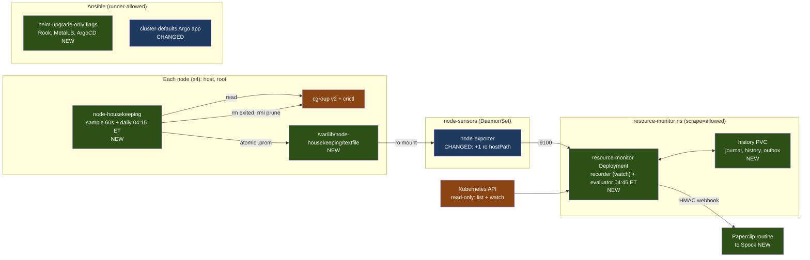

# Cluster Resource Monitor

The cluster resource monitor records node and container measurements before
daily cleanup, preserves short lived containers in history, and reports gaps
that prevent a clean measurement window. Pro owns the host collector and the
resource-monitor application; node-sensors exposes their host textfile metrics
through node-exporter.

## Host housekeeping

Pro Ansible installs the host collector only when the runner is invoked with
`enable_node_housekeeping=true`. The flag defaults to `false`; with it off, the
playbook neither installs nor removes host files.

Each of the four cluster nodes runs `/usr/local/libexec/node-housekeeping` as
root through two systemd timers:

| Timer | Schedule | Work |
|---|---|---|
| `node-housekeeping-sample.timer` | Every 60 seconds (`OnUnitActiveSec=60s`) | Sample each Kubernetes container cgroup and atomically publish container high-water metrics. |
| `node-housekeeping-daily.timer` | 04:15 America/New_York, persistent across downtime | Snapshot exited containers, images and `/` usage, then clean up eligible exited containers and unused images. |

The 04:15 run records the pre-cleanup counts and root filesystem usage first.
It then re-checks each candidate with `crictl inspect` and removes it only if
its state is still exited. It runs `crictl rmi --prune` afterwards. Running or
paused containers are never removed, and kubelet garbage-collection settings
are not changed. Freed bytes are the positive reduction in root filesystem
usage across the cleanup.

The sampler uses each container ID as its lifetime key. Working-set use is
`memory.current - inactive_file`; anon use is read from `memory.stat`. The
working-set and anon high-water values never decrease during that container
lifetime. A restart has a new ID and starts a new high-water record. The
collector caches namespace, pod, pod UID and container identity from
`crictl inspect` labels.

When a cgroup disappears, the last sample that saw it becomes its end
timestamp. The collector retains its identity, high-water values, cgroup
`memory.peak` and `oom_kill` count with `state="ended"` for 14 days. This keeps
short-lived backup Jobs available to the next scrape and lets the monitor join
them to the pod's requests, limits and workload record. A container that lives
and ends between two samples may not have a host record; the monitor reports
that as `peak_unmeasured`.

The sampler stores its previous sample time and cumulative gap counter on
disk. If two consecutive samples are more than 120 seconds apart, the full
interval is added to `node_housekeeping_sampler_gap_seconds_total`, including
intervals that span a reboot. A rise in this counter makes the monitor's
observation window unclean.

The script atomically replaces
`/var/lib/node-housekeeping/textfile/housekeeping.prom` using a temporary file
in the same directory and rename. Node-exporter v1.12.1 reads this host
directory through a read-only `Directory` hostPath mount at `/host-textfile`;
the sensor helper and its in-memory file are unchanged.

### Host metric contract

Per-container series carry `namespace`, `pod`, `pod_uid`, `container`,
`container_id` and `state` labels (`running` or `ended`). End timestamp is
exported for ended containers only.

| Series | Unit | Source and meaning |
|---|---|---|
| `node_housekeeping_exited_containers` | count | Daily count from `crictl ps -a --state exited -q`, before cleanup. |
| `node_housekeeping_images` | count | Daily count from `crictl images -q`, before cleanup. |
| `node_housekeeping_rootfs_used_bytes` | bytes | Used bytes on `/`, before cleanup. |
| `node_housekeeping_rootfs_size_bytes` | bytes | Total bytes on `/`, before cleanup. |
| `node_housekeeping_removed_containers` | count | Exited containers successfully removed after state re-check. |
| `node_housekeeping_removed_images` | count | Images absent after `crictl rmi --prune`. |
| `node_housekeeping_freed_bytes` | bytes | Positive decrease in `/` used bytes across cleanup. |
| `node_housekeeping_container_working_set_peak_bytes` | bytes | 60-second high-water of `memory.current - inactive_file`. |
| `node_housekeeping_container_anon_peak_bytes` | bytes | 60-second high-water of cgroup anon bytes. |
| `node_housekeeping_container_memory_peak_bytes` | bytes | Cgroup `memory.peak`, including page cache. |
| `node_housekeeping_container_oom_kills` | count | Cgroup `memory.events` `oom_kill` value. |
| `node_housekeeping_container_start_timestamp_seconds` | seconds | First sample for the container ID. |
| `node_housekeeping_container_end_timestamp_seconds` | seconds | Last sample that saw an ended container ID. |
| `node_housekeeping_sampler_gap_seconds_total` | seconds | Persistent sum of sampling intervals longer than 120 seconds. |
| `node_housekeeping_last_run_timestamp_seconds{run}` | seconds | Last successful sample or daily run timestamp. |

## Privilege and rollback

The collector runs as root on the host because it reads cgroup files and uses
the local CRI socket for inspection and cleanup. Neither node-sensors
container gains host privilege, capabilities, devices, a service-account token
or RBAC. Node-exporter receives only a read-only mount of the textfile output;
the housekeeping state and CRI socket are not mounted into the pod.

The exact host rollback is a runner run with:

```text
-e enable_node_housekeeping=true -e node_housekeeping_state=absent
```

The absent path stops and disables both timers and their services, removes the
four unit files, reloads systemd, and deletes the installed script,
`housekeeping.prom` and sampler state files. It keeps the empty
`/var/lib/node-housekeeping/state` and
`/var/lib/node-housekeeping/textfile` directories so node-sensors' `Directory`
hostPath remains valid until the DaemonSet mount is reverted. Setting the
enable flag to false is not a rollback.

## Architecture


